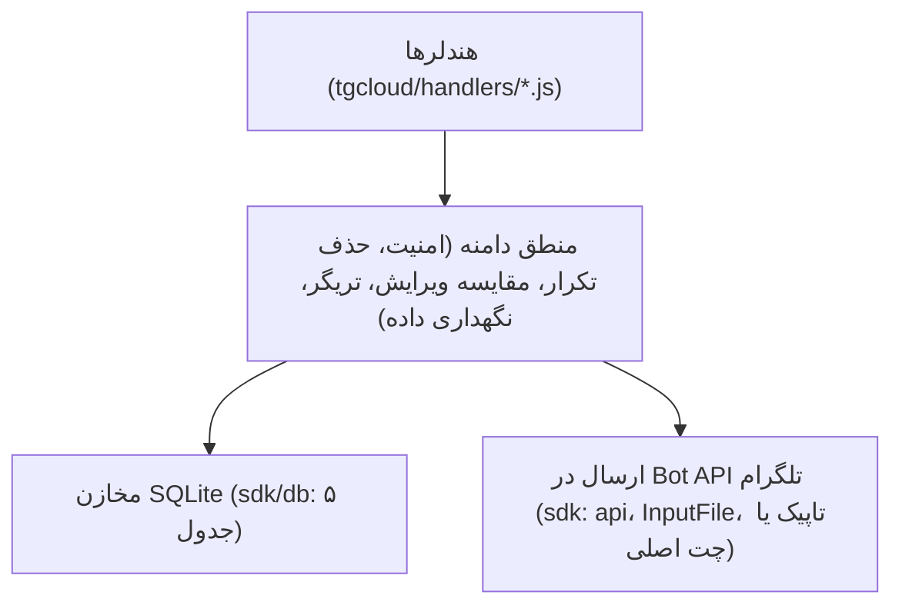

**دستیار هوشمند تلگرام بیزینس** برای **تلگرام سرورلس (Telegram Serverless)** با `@tgcloud/cli ^0.2.0` ساخته شده و توابع بدون‌وضعیت را در ایزوله‌های V8 همراه با یک دیتابیس داخلی SQLite اجرا می‌کند.

## قوانین زمان اجرای V8 سرورلس

- **بدون وابستگی در زمان اجرا:** کد مستقرشده با صفر `node_modules` اجرایی کار می‌کند. ماژول‌های داخل `tgcloud/` فقط مجاز به ایمپورت `sdk` داخلی (`db`، `api`، `fetch`، `InputFile`، `BotApiError`) / `sdk/db` و فایل‌های نسبی `.js` درون `tgcloud/` هستند.
- **ساختار تخت هندلرها:** پوشه `tgcloud/handlers/` کاملاً تخت (فقط در یک سطح) نگهداری می‌شود.
- **معماری تماماً ربات‌محور:** فایل `tgcloud.jsonc` هیچ `"static"` فرانت‌اندی تعریف نمی‌کند و هیچ مسیر `endpoints/` برای Mini App وجود ندارد.

## نمودار معماری اجزا



## ۵ هندلر رسمی آپدیت (`tgcloud/handlers/`)

| فایل هندلر | نوع آپدیت | مسئولیت |
| :--- | :--- | :--- |
| `message.js` | `message` | پردازش دستورات خصوصی مالک (`/start`، `/trigger`، `/autodelete`) و بوت‌استرپ CLI مالک (`{owner_id}` با `{ci_bootstrap: true}`)؛ نادیده گرفتن غیراصلی‌ها و گروه‌ها. |
| `business_connection.js` | `business_connection` | بررسی دسترسی تک‌مالک، به‌روزرسانی `connections.is_enabled` و ارسال پیام **🔗 Telegram Business Connected**. |
| `business_message.js` | `business_message` | بایگانی پیام‌های ورودی و خروجی بیزینس، اجرای ذخیره یک‌بارمشاهده و حذف خودکار تریگر در ریپلای مالک و اجرای ~۲٪ پاک‌سازی فرصت‌طلبانه. |
| `edited_business_message.js` | `edited_business_message` | پالایش آپدیت‌های غیرمعنادار با `isMeaningfulEdit`، ثبت در `messages.edit_history` با کنترل خوش‌بینانه `edit_date` و ارسال گزارش بی‌صدای ۱ یا ۳ پیامی. |
| `deleted_business_messages.js` | `deleted_business_messages` | ثبت اتمیک پیام‌های ورودی حذف‌شده (تا سقف `MAX_DELETE_BATCH = 25`)، بازسازی آلبوم‌ها (`sendMediaGroup`) یا خلاصه ۴۰۰۰ کاراکتری و گزارش حذف‌های بایگانی‌نشده. |

## اسکیمای دیتابیس SQLite (`tgcloud/schema.js`)

| نام اکسپورت اسکیما | جدول SQLite | کاربرد و تضمین‌های کلیدی |
| :--- | :--- | :--- |
| `connections` | `connections` | نگهداری وضعیت اتصال بیزینس از جمله `is_enabled` (`false` هنگام غیرفعال‌سازی سراسری). |
| `settings` | `settings` | ذخیره `owner_id`، متن تریگر یک‌بارمشاهده، وضعیت `/autodelete` و زمان خنک‌سازی `topics_disabled_until`. |
| `messages` | `messages` | بایگانی پیام‌ها (`is_incoming`، `edit_history`، وضعیت ذخیره یک‌بارمشاهده) همراه با اندیس یکتا روی `(business_connection_id, chat_id, message_id)`. |
| `rawUpdates` | `raw_updates` | ذخیره اختیاری آپدیت‌های خام هنگام `DEBUG_RAW_UPDATES = true` (با نگهداری `3` روزه). |
| `contactTopics` | `contact_topics` | نگاشت هر مخاطب بیزینس به تاپیک اختصاصی در چت خصوصی با وضعیت لیز اتمیک `status`: `'creating' \| 'ready'`. |

## نگهداری و قوانین اسکیمای سرورلس

### دستورات متداول `tgcloud`

```bash
npx tgcloud status         # یا: npm run status
npx tgcloud push           # یا: npm run deploy (فقط کد؛ بدون تغییر دیتابیس)
npx tgcloud migrate --dry-run
npx tgcloud migrate --safe
npx tgcloud migrate --yes
npx tgcloud webhook
npx tgcloud webhook sync
```

### قوانین اسکیمای SQLite در تلگرام سرورلس

- **ممنوعیت کلید خارجی (Foreign Keys):** تنظیم `PRAGMA foreign_keys` خاموش است و فراخوانی `.references()` یا `foreignKey()` باعث خطا می‌شود.
- **حذف امن ستون یا جدول:** ابتدا ستون یا جدول منسوخ را با `.deprecated('reason')` علامت‌گذاری کنید و سپس `npx tgcloud migrate` را اجرا نمایید.
- **تغییر نوع ستون:** تغییرات نوع ستون را به صورت دستی با `db.run(...)` انجام دهید.

## مشارکت، حریم خصوصی و مجوز

- **مرزهای مشارکت در کد:** تمام کدهای زمان اجرا را داخل `tgcloud/` و فقط با ایمپورت‌های `sdk` / `sdk/db` و مسیرهای نسبی `.js` نگه دارید، ساختار تخت `tgcloud/handlers/` را حفظ کنید و هیچ `node_modules` زمان اجرا اضافه نکنید.
- **اعلان حریم خصوصی:** این دستیار منحصراً برای استفاده شخصی و تک‌مالک در تلگرام بیزینس طراحی شده است. مالک ربات شخصاً مسئول رعایت قوانین محلی حریم خصوصی و رضایت کاربران و همچنین شرایط خدمات تلگرام و قوانین توسعه‌دهندگان ربات است.
- **مجوز انتشار:** تحت **Mozilla Public License 2.0 (`MPL-2.0`)** منتشر شده است.

## صفحات مرتبط

- [معرفی و قابلیت‌ها](/fa/projects/chat-automation/) — مرور قابلیت‌های اصلی و جریان پردازش آپدیت‌ها.
- [راه‌اندازی و دیپلوی](/fa/projects/chat-automation/setup/) — تنظیمات `@BotFather`، دیپلوی CI/محلی و دسترسی‌های تلگرام بیزینس.
- [دستورات و پیکربندی](/fa/projects/chat-automation/commands-config/) — دستورات خصوصی مالک و پیش‌فرض‌های `tgcloud/lib/config.js`.
