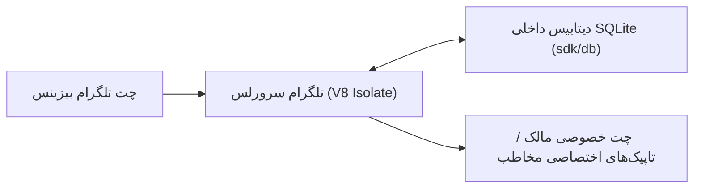

**دستیار هوشمند تلگرام بیزینس** ([AZiPA/telegram-chat-automation](https://github.com/AZiPA/telegram-chat-automation)) یک دستیار شخصی و تک‌مالک برای حساب‌های **تلگرام بیزینس (Telegram Business)** است. این پروژه برای **تلگرام سرورلس (Telegram Serverless)** با `@tgcloud/cli ^0.2.0` طراحی شده و در محیط ایزوله V8 همراه با دیتابیس داخلی SQLite (مبتنی بر DSL شبه‌Drizzle در `sdk/db`)، بدون نیاز به `node_modules` در زمان اجرا و بدون سرور مجازی (VPS)، کانتینر یا میزبانی خارجی اجرا می‌شود.

:::note[پروژه سرورلس تماماً ربات‌محور]
فایل `tgcloud.jsonc` هیچ بخش `"static"` یا فرانت‌اند تعریف نمی‌کند و هیچ مسیر `endpoints/` برای Mini App وجود ندارد. تمام تعامل‌ها مستقیماً درون تلگرام—بین چت‌های بیزینس و چت خصوصی شما با ربات—انجام می‌شود. فایل `package.json` به عنوان یک پروژه استقرار ربات از `"private": true` استفاده می‌کند و تحت مجوز `MPL-2.0` منتشر شده است.
:::

## جریان کلی پردازش آپدیت‌ها

## قابلیت‌های اصلی

### ۱. بازیابی پیام‌های حذف‌شده و خلاصه دسته‌ای

این قابلیت از طریق رویداد `deleted_business_messages` پردازش می‌شود:

- **جلوگیری از تکرار اتمیک و سرصفحه بی‌طرف:** پیام‌های ورودی حذف‌شده را به صورت اتمیک ثبت می‌کند تا در ارسال مجدد وبهوک (Webhook Retry) هشدار تکراری ارسال نشود و از سرصفحه‌های بی‌طرف (`🗑 Message Deleted` / `🗑 Messages Deleted`) بدون حدس زدن درباره حذف‌کننده پیام استفاده می‌کند.
- **حفظ کامل ساختار و قالب‌بندی:** قالب‌بندی اصلی (`entities` / `caption_entities`)، خلاصه محتوای ساختاریافته (`contact`، `location`، `venue`، `poll`، `dice` و موارد مشابه) و فراداده `forward_origin` را حفظ می‌کند.
- **دسته‌بندی هوشمند پیام‌های هم‌زمان:** حذف‌های هم‌زمان را زیر یک سرصفحه دسته‌ای ادغام می‌کند: متن‌ها و پیام‌های ساختاریافته در گزارش‌های امن حداکثر ۴۰۰۰ کاراکتری ادغام می‌شوند و آلبوم‌های رسانه (`media_group_id`) در دسته‌های ۲ تا ۱۰ تایی با `sendMediaGroup` بازسازی می‌گردند.
- **محدوده امن و بدون اعلان مزاحم برای پیام‌های ارسالی:** در هر آپدیت حداکثر `25` پیام ورودی بایگانی‌شده را پردازش می‌کند (`MAX_DELETE_BATCH = 25`) و در صورت عبور از سقف، اعلان سرریز می‌فرستد. همچنین پیام‌های حذف‌شده قبل از اتصال ربات را در قالب خلاصه گزارش می‌دهد (`NOTIFY_UNARCHIVED_DELETES = true`). حذف پیام‌های ارسالی خودتان (`is_incoming = false`) هیچ اعلان مزاحمی تولید نمی‌کند.

### ۲. ردیابی بی‌صدای ویرایش‌ها

این قابلیت از طریق رویداد `edited_business_message` مدیریت می‌شود:

- **اسنپ‌شات هم‌روند و ارسال بی‌صدا:** تاریخچه ویرایش‌ها را با بررسی هم‌روندی خوش‌بینانه `edit_date` در ستون `messages.edit_history` ذخیره می‌کند و گزارش‌ها را به صورت بی‌صدا (`disable_notification: true`) می‌فرستد.
- **پالایش آپدیت‌های کاذب:** آپدیت‌های کاذب تلگرام—مانند تولید خودکار پیش‌نمایش لینک بدون تغییر در متن، `entities`، رسانه یا فراداده—را از طریق `isMeaningfulEdit` فیلتر می‌کند.
- **حالت فشرده تک‌پیامی:** برای متن‌های ساده و بدون قالب‌بندی تا مجموع `3,000` کاراکتر، تغییرات را در یک پیام با بلوک بازشونده `<blockquote expandable>` نمایش می‌دهد.
- **حالت سه‌پیامی با حفظ قالب‌بندی:** برای متن‌های قالب‌دار، پیام‌های طولانی، کپشن‌ها و جایگزینی رسانه، پیام‌های `🔴 Before:` و `🟢 After:` را با جابه‌جایی دقیق آفست‌های UTF-16 در `entities`—و در صورت تغییر `fileUniqueId` به همراه نسخه‌های قبل و بعد رسانه—ارسال می‌کند.

### ۳. ذخیره رسانه یک‌بارمشاهده و تریگر هوشمند ترکیبی

- **ذخیره پیش از باز کردن:** رسانه‌های یک‌بارمشاهده (View-Once) از نوع `photo`، `video`، `voice` و `video_note` را هنگامی که مالک **پیش از باز کردن** روی آن‌ها ریپلای بزند ذخیره می‌کند—حتی اگر تلگرام در ابتدا یک `view_once_placeholder` بدون `file_id` تحویل داده باشد.
- **مسیر جایگزین مقاوم در برابر خطا:** در صورت خطا در ارسال مستقیم با `file_id`، فایل را تا سقف `20 MB` محدودیت Bot API دانلود کرده (`MAX_GETFILE_BYTES = 20971520`) و از طریق `InputFile` مجدداً آپلود می‌کند. اگر ارسال باز هم ناموفق باشد، قفل ثبت در دیتابیس را بازمی‌گرداند تا امکان تلاش مجدد وجود داشته باشد.
- **تریگر هوشمند ترکیبی (Hybrid Smart Trigger):** *هر* ریپلایی روی رسانه یک‌بارمشاهده ذخیره‌نشده آن را ثبت می‌کند؛ اما ریپلای‌هایی که دقیقاً با متن تریگر پیکربندی‌شده مطابقت داشته باشند (پیش‌فرض `.`، بدون حساسیت به حروف کوچک و بزرگ)، در صورت روشن بودن `/autodelete` و داشتن دسترسی `can_delete_all_messages` به طور خودکار با `deleteBusinessMessages` حذف می‌شوند.

### ۴. تاپیک‌های اختصاصی برای هر مخاطب (`Threaded Mode`)

- **جداسازی گفت‌وگوهای هر مخاطب:** با فعال کردن **Threaded Mode** در `@BotFather`، برای هر مخاطب یک تاپیک (Forum Topic) با عنوان `👤 Name (@username)` یا `👤 Name [id]` ساخته می‌شود. ربات برای جلوگیری از ساخت تاپیک تکراری از قفل لیز اتمیک دیتابیس (`contact_topics` با وضعیت `'creating'` / `'ready'`) استفاده می‌کند، تغییر نام مخاطبان را همگام می‌سازد و در صورت بسته یا حذف شدن تاپیک، آن را خودکار ترمیم می‌کند.
- **بازگشت خودکار به چت اصلی و دوره خنک‌سازی:** اگر Threaded Mode در دسترس نباشد، اعلان‌ها به چت خصوصی اصلی ربات ارسال می‌شوند و یک دوره خنک‌سازی ۱۰ دقیقه‌ای (`topics_disabled_until`) ثبت می‌گردد. اجرای `/start` این محدودیت زمانی را بلافاصله پاک می‌کند.

### ۵. امنیت Fail-Closed تک‌مالک و جابه‌جایی تمیز مالک

- **کنترل مالکیت سخت‌گیرانه:** هویت مالک منحصراً از `owner_id` در جدول `settings` خوانده می‌شود؛ در صورت نبود یا نامعتبر بودن آن، `getOwnerId()` مقدار `null` برمی‌گرداند و تمام دستورات، اتصال‌های بیزینس و هندلرها دسترسی را رد می‌کنند.
- **بدون رمزگذاری ثابت در کد و جابه‌جایی پاک:** نه `TGCLOUD_TOKEN` و نه `OWNER_ID` در کد منبع قرار ندارند. با تغییر `OWNER_ID`، تابع `setOwnerId()` رکوردهای قدیمی `contact_topics`، `connections` و `topics_disabled_until` مربوط به مالک قبلی را پاک‌سازی می‌کند اما `messages` بایگانی‌شده را دست‌نخورده نگه می‌دارد.

### ۶. نگهداری دوره‌ای داده‌ها و لاگ خام اختیاری

- **پاک‌سازی فرصت‌طلبانه:** در حدود ۲٪ از آپدیت‌های `business_message`، رکوردهای `messages` قدیمی‌تر از `30` روز (`RETENTION_DAYS`) و رکوردهای `raw_updates` قدیمی‌تر از `3` روز (`RAW_UPDATES_RETENTION_DAYS`) را به صورت خودکار پاک‌سازی می‌کند.
- **حریم خصوصی پیش‌فرض:** مقدار `DEBUG_RAW_UPDATES` به طور پیش‌فرض `false` است تا داده‌های خام ذخیره نشوند مگر آن‌که برای اشکال‌زدایی فعال گردد.

## گام‌های بعدی

- [راه‌اندازی و دیپلوی](/fa/projects/chat-automation/setup/) — پیکربندی `@BotFather`، دیپلوی با GitHub Actions یا `@tgcloud/cli`، ثبت `OWNER_ID` و فعال‌سازی دسترسی‌های تلگرام بیزینس.
- [دستورات و پیکربندی](/fa/projects/chat-automation/commands-config/) — بررسی دستورات مالک در چت خصوصی و ثابت‌های `tgcloud/lib/config.js`.
- [معماری، دیتابیس و نگهداری](/fa/projects/chat-automation/architecture/) — آشنایی با قوانین زمان اجرای V8، ۵ هندلر، ۵ جدول SQLite و نگهداری پروژه.
