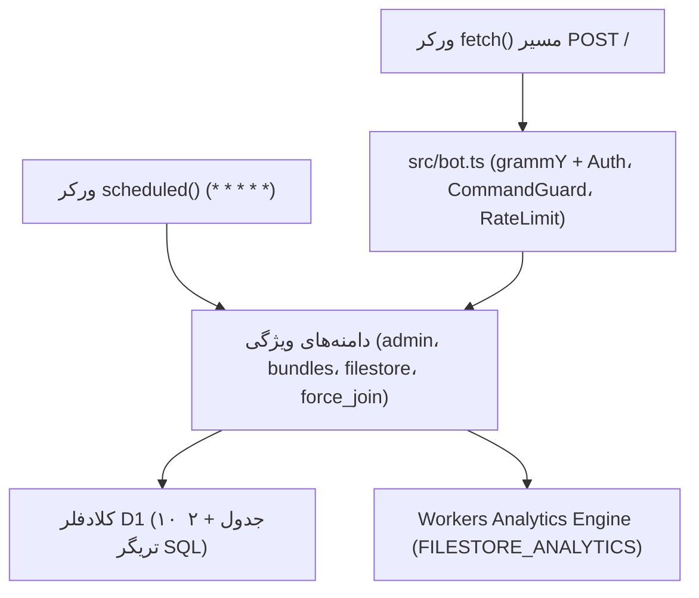

**ربات آپلودر تلگرام (نسخه کلادفلر ورکرز)** نقطه ورود تمیز TypeScript ورکر (`src/index.ts`)، خط لوله `grammy` (`src/bot.ts`)، کوئری‌های پارامتری خام **کلادفلر D1**، تله‌متری **Workers Analytics Engine** و یک **Cron Trigger** چندزمان‌بندی را با هم ترکیب می‌کند.

## ۱. معماری اجزا

## ۲. ساختار ماژولار `src/`

| ماژول / پوشه | مسئولیت |
| :--- | :--- |
| `src/index.ts` | هندلر `fetch` کلادفلر ورکر (بررسی متد/مسیر/Secret و حذف کاربران مسدود پیش از میان‌افزار) و هندلر کرون `scheduled`. |
| `src/bot.ts` | راه‌اندازی نمونه `grammy ^1.46.0`، زنجیره میان‌افزارها و مسیریاب‌های ویژگی‌ها. |
| `src/config.ts` | تعریف ثابت‌های `LIMITS`، `UI_CONFIG`، `QUOTA_CACHE_CONFIG` و `LOGGING_CONFIG`. |
| `src/core/` | ماژول‌های `logger.ts` (`LoggerService.alert` + Analytics Engine) و `types.ts` (`Env` و تایپ‌های کانتکست). |
| `src/features/` | ماژول‌های دامنه شامل `admin/`، `bundles/`، `filestore/` و `force_join/`. |
| `src/locales/` | فایل‌های `en.ts` و `fa.ts` با مجموع **۳۲۲ کلید** (۳۲۱ رشته رابط کاربری + `ordinals`)، اعتبارسنجی‌شده با `scripts/verify.mjs`. |
| `src/middlewares/` | میان‌افزارهای `auth.ts` (تشخیص `OWNER_ID` و نقش)، `command_guard.ts` و `rate_limit.ts` (`3 req / 5s`). |
| `src/shared/` | ماژول‌های `buttons.ts` (استایل Bot API 9.4)، `crypto.ts` (Base62، UUID، SHA-256) و `formatters.ts`. |

## ۳. خط لوله زمان‌بندی کرون (`crons = ["* * * * *"]`)

هندلر تک‌دقیقه‌ای `scheduled()` وظایف را در سه بازه زمانی تقسیم می‌کند:

| دوره زمانی | شرط اجرا | عملیات انجام‌شده |
| :--- | :--- | :--- |
| **هر دقیقه** | همیشگی (`* * * * *`) | تا `25` رکورد سررسیدشده `deletion_queue` را (`delete_at <= unixepoch()`، `LIMIT 25`) جاروب کرده و در هر فراخوانی `api.deleteMessages()` تا `100` پیام را حذف می‌کند (سقف قطعی `35` ساب‌ریکوئست Bot API؛ توقف فوری در HTTP 429). |
| **هر ۱۵ دقیقه** | `UTC minute % 15 === 0` | تا `10` بسته یک‌بارمصرف منقضی یا رهاشده را پاک‌سازی کرده و تا `5` بسته چرخان کانال را به UUID جدید چرخانده و دکمه پست کانال را با `api.editMessageReplyMarkup()` به‌روزرسانی می‌کند (غیرفعال‌سازی خودکار در HTTP 400/403). |
| **هفتگی** | یکشنبه `00:00–03:00 UTC` | به صورت فرصت‌طلبانه تا `25` ردیف قدیمی‌تر از `7` روز را در هر تیک از `user_downloads` از طریق `executionCtx.waitUntil()` پاک‌سازی می‌کند. |

## ۴. اسکیمای کلادفلر D1 (`schema.sql`)

دیتابیس D1 شامل **۱۰ جدول** و **۲ تریگر SQL** است که منحصراً با دستورات پارامتری خام (`env.DB.prepare(...).bind(...)` و `env.DB.batch(...)`) فراخوانی می‌شوند:

### ۱۰ جدول D1

| جدول | کاربرد |
| :--- | :--- |
| `bundles` | نگهداری فراداده بسته‌ها (`code`، `protect_content`، `is_one_time`، `consumed_by`، `passcode_hash`، `expires_at`، تنظیمات چرخش و JSON تک‌ردیفی `items`). |
| `admin_sessions` | ردیابی نشست‌های باز `/upload`، `/batch` و `/edit` با تایم‌اوت `600` ثانیه‌ای عدم فعالیت. |
| `bundle_votes` | ذخیره آرای `👍 / 👎` کاربران به ازای هر بسته. |
| `deletion_queue` | زمان‌بندی شناسه‌های پیام تحویل‌شده و برچسب زمان `delete_at` برای پاک‌سازی کرون دقیقه‌ای. |
| `admins` | نگهداری انتصاب‌های `owner`، `super_admin` و `admin`. |
| `vips` | نگهداری شناسه کاربران VIP و زمان انقضا (`0` برای مادام‌العمر). |
| `user_quotas` | ردیابی وضعیت مسدودیت و جایگزین‌های نرخ/سهمیه هر کاربر. |
| `user_downloads` | ثبت تعداد دانلود روزانه و هر بسته کاربران تحت کنترل تریگرهای SQL. |
| `system_config` | نگهداری پایدار تنظیمات پویا (`daily_limit`، `file_daily_limit`، `maintenance_mode`، `auto_delete_seconds` و غیره). |
| `force_channels` | نگهداری حداکثر `8` کانال عضویت اجباری، متن دکمه‌ها، لینک دعوت و سقف هدف عضویت. |

### ۲ تریگر کنترلی SQL

| تریگر | کاربرد |
| :--- | :--- |
| `trg_user_downloads_limit_insert` | هنگام رسیدن کاربر به سقف روزانه یا سقف هر لینک، عملیات `INSERT` در `user_downloads` را به صورت اتمیک مسدود می‌کند. |
| `trg_user_downloads_limit_update` | هنگام افزایش شمارنده فراتر از حد مجاز روزانه یا هر لینک، عملیات `UPDATE` روی `user_downloads` را به صورت اتمیک متوقف می‌سازد. |

## ۵. مهندسی محدودیت‌های سطح رایگان کلادفلر ورکرز و D1

- **سقف ۱۰ میلی‌ثانیه CPU هم‌زمان:** با استفاده از I/O غیرمسدودکننده، تغییرات اتمیک Compare-And-Swap و کش‌های LRU محدود `CappedMap` در حافظه (`QUOTA_CACHE_CONFIG`، کش ۵ دقیقه‌ای آمار) مصرف CPU در حد بسیار پایین نگه داشته می‌شود.
- **سقف ۵۰ ساب‌ریکوئست:** تعداد ساب‌ریکوئست‌های خروجی Bot API در هر اجرا روی **۳۵** محدود شده (و در صورت وجود `storage_message_id` از `api.copyMessages()` یک‌ساب‌ریکوئستی استفاده می‌شود) تا حاشیه امن حفظ گردد، در حالی که کوئری‌های D1 از استخر مجزای ۱۰۰۰ کوئری استفاده می‌کنند.
- **۶ سوکت خروجی هم‌زمان:** ثابت `MEMBERSHIP_CONCURRENCY = 6` بررسی‌های عضویت اجباری را به موج‌های ایمن ۶ سوکتی محدود می‌کند.
- **سقف ۱۰۰ هزار نوشتن روزانه D1 / ۵ میلیون ردیف خوانده‌شده:** ذخیره فایل‌های بسته به صورت یک آرایه JSON تک‌ردیفی در `bundles.items` تعداد نوشتن در D1 را حدود **۹۶٪** نسبت به جدول‌های نرمال‌شده کاهش می‌دهد و تابع `json_array_length(items)` از خواندن بلوک‌های بزرگ JSON در `/stats` و `/search` جلوگیری می‌کند. خطاهای سقف سطح رایگان توسط `isD1FreeTierError()` با کولداون ۱ ساعته هشدار مدیریت می‌شوند.
- **آزمون ۸ مرحله‌ای `scripts/verify.mjs`:** انطباق **۳۲۲** کلید دیکشنری EN/FA را از نظر برابری کلیدها، برابری `{placeholder}`ها، توازن تگ‌های HTML، نبود کلید استفاده‌نشده و رعایت سخت‌گیرانه سقف **۶۴ بایتی** `callback_data` تلگرام در تمام ۴۰ قالب کالبک تایید می‌کند.

## مجوز انتشار

تحت **Mozilla Public License 2.0 (`MPL-2.0`)** منتشر شده است.

## گام‌های بعدی

- [معرفی و ویژگی‌ها](/fa/projects/telegram-uploader-bot-cloudflare/) — بازگشت به نمای کلی نسخه کلادفلر و مقایسه نسخه‌ها.
- [راه‌اندازی و دیپلوی](/fa/projects/telegram-uploader-bot-cloudflare/setup/) — مرور آماده‌سازی D1، گردش‌کار CI و ثبت وبهوک.
- [دستورات و پیکربندی](/fa/projects/telegram-uploader-bot-cloudflare/commands-config/) — بررسی تمام دستورات اصلی و کلیدهای پیکربندی.
