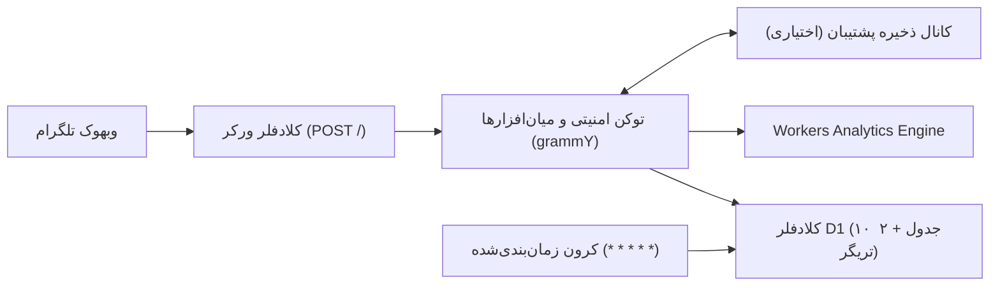

**ربات آپلودر تلگرام (نسخه کلادفلر ورکرز)** ([AZiPA/telegram-uploader-bot-cloudflare](https://github.com/AZiPA/telegram-uploader-bot-cloudflare)) نسخه لبه `v3.3.0` ربات توزیع فایل تلگرام است که با **TypeScript**، **`grammy ^1.46.0`** و **`wrangler ^4.0.0`** (`compatibility_date = "2026-10-01"`، `nodejs_compat`) روی **Cloudflare Workers** و **Cloudflare D1** ساخته شده است. این نسخه کوئری‌های پارامتری خام D1 SQL (`env.DB.prepare(...).bind(...)` و `env.DB.batch(...)`) را بدون ORM، بدون KV/R2/Durable Objects و بدون VPS اجرا می‌کند.

:::note[ورکر سرورلس تماماً سمت سرور]
این ورکر هیچ Telegram Mini App (`has_main_web_app: false`) یا فایل استاتیک فرانت‌اند ارائه نمی‌دهد و تنها یک مسیر HTTP (`POST /<WEBHOOK_PATH>`) را با احراز هویت `X-Telegram-Bot-Api-Secret-Token` میزبانی می‌کند (متد یا مسیر اشتباه پاسخ `404 Not Found` و توکن نامعتبر پاسخ `403 Forbidden` برمی‌گرداند). این پروژه تحت مجوز **Mozilla Public License 2.0 (`MPL-2.0`)** منتشر شده و دارای دیکشنری‌های دوزبانه `en` و `fa` (`src/locales/en.ts`، `src/locales/fa.ts`) با **۳۲۲ کلید** تاییدشده توسط مجموعه ۸ مرحله‌ای `scripts/verify.mjs` است.
:::

:::tip[نسخه تلگرام سرورلس را ترجیح می‌دهید؟]
اگر راه‌اندازی بدون زیرساخت ابری و مستقیم درون ایزوله‌های V8 تلگرام سرورلس همراه با دیتابیس داخلی SQLite و بدون نیاز به حساب کلادفلر، آدرس وبهوک یا تنظیم کرون را می‌خواهید، نسخه [ربات آپلودر تلگرام (نسخه تلگرام سرورلس)](/fa/projects/telegram-uploader-bot/) را مشاهده کنید.
:::

## جریان کلی پردازش در لبه

## قابلیت‌های کلیدی

### ۱. پشتیبانی از ۶ نوع رسانه و آپلود اتمیک

- **پوشش رسانه‌های اصلی:** پشتیبانی از `document`، `video`، `audio`، `photo` (بالاترین کیفیت)، `animation` و `voice`.
- **روندهای آپلود و ویرایش:** پشتیبانی از `/upload` برای تک‌فایل، `/batch` تا سقف **۲۰ آیتم در هر نشست** (`MAX_PER_SESSION_UPLOAD = 20`) و `/edit <code>` / `/review <code>` با تغییرات اتمیک Compare-And-Swap تا سقف **۲۵ آیتم در هر بسته** (`MAX_BUNDLE_ITEMS = 25`) و تایم‌اوت عدم فعالیت **۶۰۰ ثانیه** (۱۰ دقیقه).

### ۲. ارسال یک‌جا از کانال ذخیره با تنها ۱ ساب‌ریکوئست

- **آینه‌سازی هنگام ثبت:** در صورت تنظیم `STORAGE_CHANNEL_ID`، فایل‌ها با `api.copyMessage()` کپی شده و `storage_message_id` آن‌ها در JSON ستون `bundles.items` ذخیره می‌شود.
- **مسیر جایگزین پرسرعت:** وقتی همه آیتم‌های یک دسته تحویل دارای `storage_message_id` باشند، ربات تا **۱۰ فایل را در ۱ ساب‌ریکوئست** با `api.copyMessages()` ارسال می‌کند و در خطای HTTP 403 یا خطای جزئی، با ثبت `LoggerService.alert` به ارسال متوالی `file_id` برمی‌گردد.

### ۳. رابط Bot API 9.4، رمزنگاری SHA-256 و چرخه کرون

- **لینک‌ها و دکمه‌های رنگی:** بسته‌های عمومی کد ۸ کاراکتری Base62 دارند؛ بسته‌های محافظت‌شده، چرخان، یک‌بارمصرف یا قفل‌شده با پین به UUID v4 سی‌وشش کاراکتری (`?start=<code>` یا `?start=<code>_<pin>`) ارتقا می‌یابند. تحویل ۱۰ تایی شامل دکمه‌های رنگی Bot API 9.4 (`primary`، `success`، `danger`) و رای‌گیری `👍 / 👎` (`bundle_votes`) است.
- **محافظت رمز عبور SHA-256 (`/setpass`):** قفل‌گذاری بسته‌ها با پین ۴ تا ۳۲ کاراکتری هش‌شده با Web Crypto SHA-256 (`${code}:${pin}`) همراه با **قفل ضد بروت‌فورس ۵ تلاش ناموفق → ۳۰ دقیقه مسدودیت** (با صفر نوشتن در D1).
- **اتوماسیون زمان‌بندی‌شده کرون:** اجرای دقیقه‌ای (`* * * * *`) برای پاک‌سازی `deletion_queue`، اجرای هر ۱۵ دقیقه برای حذف بسته‌های منقضی/یک‌بارمصرف رهاشده و چرخش لینک پست‌های کانال، و پاک‌سازی هفتگی `user_downloads`.

### ۴. قفل عضویت اجباری و سلسله‌مراتب ۵ سطحی

- **عضویت اجباری محدودشده:** بررسی تا **۸** کانال در موج‌های حداکثر **۶** اتصال هم‌زمان (`MEMBERSHIP_CONCURRENCY = 6`، Fail-Closed در خطاهای شبکه/فلاد) با کولداون ۳ ثانیه‌ای دکمه تایید و سقف هدف عضویت.
- **سلسله‌مراتب مبتنی بر Secret و تریگرهای سهمیه SQL:** تفکیک رتبه ۴ (`Owner`)، رتبه ۳ (`Super Admin`)، رتبه ۲ (`Admin`)، رتبه ۱ (`VIP` با سهمیه ۵ برابر روزانه و ۳ برابر هر لینک) و رتبه ۰ (`User` با ۱۰ دانلود روزانه و ۳ دانلود هر لینک کنترل‌شده با تریگرهای D1 SQL)، به همراه پشتیبان JSON اتمیک در `/factoryreset confirm` و `/restore`.

## گام‌های بعدی

- [راه‌اندازی و دیپلوی](/fa/projects/telegram-uploader-bot-cloudflare/setup/) — پیکربندی `@BotFather`، کلادفلر D1، مجوزهای توکن API، Secretها، GitHub Actions CI و ثبت وبهوک.
- [آپلود، تحویل و امنیت محتوا](/fa/projects/telegram-uploader-bot-cloudflare/features-delivery/) — بررسی ارسال یک‌جای کانال ذخیره، رمز عبور SHA-256 (`/setpass`)، رابط Bot API 9.4 و عضویت اجباری.
- [نقش‌ها، امنیت و مدیریت](/fa/projects/telegram-uploader-bot-cloudflare/roles-security/) — مطالعه ماتریس سهمیه ۵ سطحی، احراز هویت `OWNER_ID`، محدودکننده نرخ و پشتیبان JSON با `/restore`.
- [دستورات و پیکربندی](/fa/projects/telegram-uploader-bot-cloudflare/commands-config/) — مرور دستورات اصلی بر اساس نقش، بایندینگ‌های `Env`، کلیدهای `system_config` و ثابت‌های زمان اجرا.
- [معماری، دیتابیس D1 و کرون](/fa/projects/telegram-uploader-bot-cloudflare/architecture/) — بررسی زمان‌بندی کرون، ۱۰ جدول D1، ۲ تریگر SQL و بهینه‌سازی‌های سطح رایگان کلادفلر.
