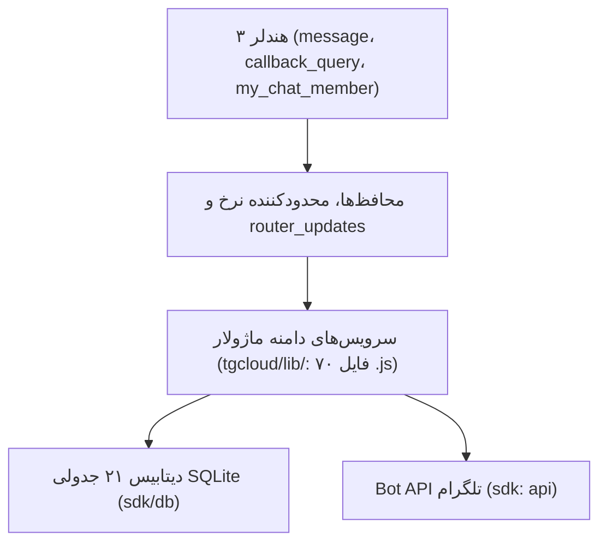

**ربات آپلودر تلگرام (نسخه تلگرام سرورلس)** به طور کامل درون زمان اجرای V8 تلگرام سرورلس (`@tgcloud/cli 0.2.0`) اجرا می‌شود و سرویس‌های ماژولار جاوااسکریپت را با یک اسکیمای SQLite شامل ۲۱ جدول (`tgcloud/schema.js`) ترکیب می‌کند.

## ۱. قوانین زمان اجرای V8 سرورلس

- **بدون وابستگی زمان اجرا:** هیچ `node_modules` اجرایی، هیچ خوانش `process.env` و هیچ ایمپورت ماژول داخلی Node.js درون `tgcloud/` وجود ندارد. ماژول‌ها فقط مجاز به ایمپورت `sdk` / `sdk/db` و فایل‌های نسبی `.js` هستند.
- **استقرار تماماً سمت سرور:** فایل `tgcloud.jsonc` فاقد `"static"` است و هیچ پوشه `tgcloud/endpoints/` وجود ندارد.
- **الزام `await` روی کوئری‌ها:** تمام کوئری‌های نهایی `sdk/db` یک Promise برمی‌گردانند و پیش از پایان اجرای ایزوله حتماً باید `await` شوند.
- **حافظه موقت ایزوله:** ساختارهای درون‌حافظه‌ای (مانند کش ۱۵ ثانیه‌ای عضویت اجباری) با چرخش ایزوله V8 پاک می‌شوند؛ وضعیت پایدار همیشه در SQLite نگهداری می‌شود.

## ۲. نمودار معماری اجزا

## ۳. ساختار ماژولار `tgcloud/lib/`

منطق برنامه در **۷۰ فایل `.js`** بر اساس دامنه تقسیم شده و همراه با **۲۷۲ کلید ترجمه** با انطباق کامل ۱۰۰٪ بین `en` و `fa` ارائه می‌شود:

| پوشه | مسئولیت |
| :--- | :--- |
| `admin/` | بررسی سطوح دسترسی، VIPها، مسدودیت‌ها، تنظیمات سراسری، مدیریت عضویت اجباری و کنسول `/sql` / `/terminal`. |
| `bundles/` | ساخت بسته، هاب مدیریت (`/manage`)، نام‌گذاری، جست‌وجو، انقضا (TTL)، رای‌گیری و چرخش لینک. |
| `core/` | مسیریاب (`router`)، جلوگیری اتمیک از تکرار (`update_ledger`) و نگهداری فرصت‌طلبانه `background` (فاصله CAS سی ثانیه‌ای `last_maint_at` + لیز ۱۸۰ ثانیه‌ای `maintenance_lease`). |
| `filestore/` | مدیریت نشست‌های `/upload` و `/batch`، آینه‌سازی کانال ذخیره، تحویل بخش‌بندی‌شده و بازیابی `source_dead`. |
| `force_join/` | بررسی موازی در موج‌های ۶ سوکتی، کش ۱۵ ثانیه‌ای، کولداون ۳ ثانیه‌ای تایید و مدیریت لینک دعوت هنگام تنظیم. |
| `locales/` | دیکشنری‌های دوزبانه `en` و `fa` شامل **۲۷۲ کلید** با انطباق کامل. |
| `middlewares/` | قفل Fail-Closed وضعیت صفر، محافظ چت خصوصی، دروازه تعمیر و نگهداری و محدودکننده نرخ پنجره لغزان. |
| `services/` | پوشش‌دهنده‌های Bot API، همگام‌سازی زنده دکمه `/postbundle`، پاک‌سازی `deletion_queue` و مدارقطع‌کن ایموجی سفارشی. |
| `shared/` | ابزارهای Base62 و UUID v4، قالب‌بندی متن، اعتبارسنج‌ها و ثابت‌های مشترک. |

## ۴. سه هندلر رسمی آپدیت (`tgcloud/handlers/`)

| فایل هندلر | نوع آپدیت | مسئولیت |
| :--- | :--- | :--- |
| `message.js` | `message` | اجرای بوت‌استرپ CI (`ci_bootstrap`)، ثبت وضعیت صفر با `/setbotowner`، دستورات نقش‌ها، نشست‌های تعاملی با Command Breakout و دریافت رسانه. |
| `callback_query.js` | `callback_query` | پردازش صفحه‌بندی تحویل (`dl:p:o:<operation_id>:<offset>`)، تایید عضویت اجباری، رای‌گیری بسته، دکمه‌های هاب مدیریت، منوهای تنظیمات و تاییدیه‌های انتقال/ریست. |
| `my_chat_member.js` | `my_chat_member` | غیرفعال‌سازی خودکار کانال عضویت اجباری در صورت اخراج یا خروج ربات (`'kicked' \| 'left'`). |

## ۵. ۲۱ جدول دیتابیس SQLite (`tgcloud/schema.js`)

اسکیمای دیتابیس شامل **۲۱ جدول** است که در چهار گروه عملکردی سازمان‌دهی شده‌اند:

### گروه ۱ — هسته بسته‌ها و تعامل (۶ جدول)

| نام جدول | کاربرد |
| :--- | :--- |
| `bundles` | نگهداری کدهای بسته (Base62 / UUID v4)، عنوان، `protect_content`، `is_one_time`، انقضا (TTL)، بازه چرخش و پرچم `owner_locked`. |
| `bundle_votes` | ثبت رای مثبت/منفی کاربران به ازای هر بسته. |
| `deletion_queue` | صف شناسه‌های پیام تحویل‌شده و زمان هدف برای حذف دسته‌ای با `api.deleteMessages()` (تا `100` پیام در هر دسته). |
| `force_channels` | نگهداری حداکثر `8` کانال عضویت اجباری، سقف عضو، عنوان دکمه و لینک دعوت کش‌شده. |
| `system_config` | مخزن پیکربندی کلید-مقدار ساخته‌شده با `.withoutRowid()` (شامل `owner_id`، سهمیه‌ها، TTLها، اسنپ‌شات کانال‌ها و لیزهای نگهداری). |
| `bot_config` | ذخیره فراداده سطح ربات و اسنپ‌شات‌های پیکربندی. |

### گروه ۲ — کنترل دسترسی، سهمیه‌ها و نشست‌ها (۶ جدول)

| نام جدول | کاربرد |
| :--- | :--- |
| `admins` | ذخیره رکوردهای `owner`، `super_admin` و `admin` همراه با فراداده سلسله‌مراتب. |
| `vips` | نگهداری شناسه کاربران VIP و زمان انقضای اختیاری. |
| `user_quotas` | ردیابی شمارنده دانلود روزانه، پنجره لغزان محدودیت نرخ، تعداد تخلف و زمان پایان مسدودیت. |
| `user_downloads` | ثبت تاریخچه دانلود بسته و فایل برای گزارش‌گیری (`/stats`، `/top`) و کنترل سهمیه. |
| `admin_sessions` | نگهداری وضعیت نشست‌های تعاملی ادمین با TTL سیصد ثانیه‌ای و پشتیبانی از Command Breakout. |
| `user_sessions` | نگهداری وضعیت تعامل‌های فعال کاربران در میان فراخوانی‌های بدون‌وضعیت ایزوله. |

### گروه ۳ — ماشین وضعیت پایدار آپلود (۲ جدول)

| نام جدول | کاربرد |
| :--- | :--- |
| `upload_sessions` | ردیابی نشست‌های باز `/upload` و `/batch` پیش از اجرای `/done` یا `/cancel`. |
| `upload_items` | ذخیره فراداده رسانه‌های مرحله‌بندی‌شده، ترتیب آلبوم و ارجاعات کانال ذخیره (سقف `25` آیتم). |

### گروه ۴ — دفتر کل تحویل ایدمپوتنت و مسیریابی (۷ جدول)

| نام جدول | کاربرد |
| :--- | :--- |
| `delivery_operations` | نماینده یک درخواست منطقی تحویل بسته (`operation_id`) در طول صفحه‌بندی بخش‌ها. |
| `delivery_attempts` | ردیابی تلاش‌های ارسال هر بخش و تغییر مسیر به کانال ذخیره هنگام خطای `source_dead`. |
| `delivery_items` | نگاشت تک‌تک آیتم‌های بسته درون یک عملیات تحویل برای برش قطعی ۱۰ تایی. |
| `delivery_claims` | فراهم‌سازی قفل ادعای اتمیک برای بسته‌های یک‌بارمصرف (`is_one_time`) تا فقط یک دریافت‌کننده تحویل را تکمیل کند. |
| `delivery_quota_accounts` | جلوگیری از کسر تکراری سهمیه کاربر در ارسال‌های مجدد و بخش‌های صفحه‌بندی‌شده یک عملیات تحویل. |
| `admin_test_continuations` | ردیابی صفحه‌بندی پیش‌نمایش ادمین (`/review`) بدون اثرگذاری بر سهمیه‌های عمومی. |
| `router_updates` | پیاده‌سازی لیز هم‌روندی اتمیک به ازای هر `update_id` تلگرام برای جلوگیری از اجرای تکراری وبهوک. |

## ۶. قوانین مایگریشن اسکیما و مجوز انتشار

- **ممنوعیت کلید خارجی:** SQLite در تلگرام سرورلس با کلید خارجی غیرفعال اجرا می‌شود؛ فراخوانی `.references()` یا `foreignKey()` باعث خطا خواهد شد.
- **مایگریشن‌های افزایشی امن:** همیشه از `npx @tgcloud/cli migrate --safe` استفاده کنید. حذف جدول یا ستون منسوخ نیازمند علامت‌گذاری با `.deprecated('reason')` پیش از اجرای مایگریشن حذف است.
- **مجوز انتشار:** تحت **Mozilla Public License 2.0 (`MPL-2.0`)** منتشر شده است.

## گام‌های بعدی

- [معرفی و ویژگی‌ها](/fa/projects/telegram-uploader-bot/) — بازگشت به نمای کلی پروژه و جریان تحویل.
- [راه‌اندازی و دیپلوی](/fa/projects/telegram-uploader-bot/setup/) — مرور تنظیمات `@BotFather`، متغیرهای CI و دستورات CLI.
- [دستورات و پیکربندی](/fa/projects/telegram-uploader-bot/commands-config/) — بررسی تمام دستورات و کلیدهای پایدار `system_config`.
