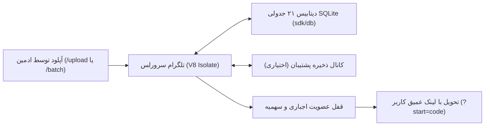

**ربات آپلودر تلگرام (نسخه تلگرام سرورلس)** ([AZiPA/telegram-uploader-bot](https://github.com/AZiPA/telegram-uploader-bot)) یک سیستم حرفه‌ای نگهداری و اشتراک‌گذاری فایل است که به صورت بومی برای **تلگرام سرورلس (Telegram Serverless)** (`@tgcloud/cli 0.2.0`) ساخته شده است. این ربات در محیط ایزوله V8 تلگرام همراه با دیتابیس داخلی SQLite اجرا می‌شود—با **صفر VPS**، **صفر میزبانی خارجی**، **صفر `node_modules` در زمان اجرا** و **صفر `process.env`**.

:::note[ربات سرورلس تماماً سمت سرور]
فایل `tgcloud.jsonc` هیچ بخش `"static"` تعریف نمی‌کند و هیچ Mini App یا پوشه `tgcloud/endpoints/` وجود ندارد. تمام فرآیندهای آپلود، تحویل فایل، بررسی عضویت اجباری و عملیات مدیریتی مستقیماً درون چت‌های تلگرام و دکمه‌های اینلاین انجام می‌شود. این پروژه تحت مجوز **Mozilla Public License 2.0 (`MPL-2.0`)** منتشر شده و دارای دیکشنری‌های دوزبانه `en` و `fa` (`tgcloud/lib/locales/`) با **۲۷۲ کلید** در انطباق ۱۰۰٪ است.
:::

:::tip[به کلادفلر ورکرز و D1 نیاز دارید؟]
اگر اجرای مبتنی بر TypeScript و `grammy`، کرون دقیقه‌ای، تله‌متری Workers Analytics Engine، رمزگذاری پین با `/setpass` و بازیابی پشتیبان JSON با `/restore` را روی لبه کلادفلر ترجیح می‌دهید، نسخه [ربات آپلودر تلگرام (کلادفلر ورکرز)](/fa/projects/telegram-uploader-bot-cloudflare/) را بررسی کنید.
:::

## جریان کلی تحویل فایل

## قابلیت‌های کلیدی

### ۱. آپلود تکی و دسته‌ای برای ۸ نوع رسانه

- **نشست‌های آپلود انعطاف‌پذیر:** از `/upload` برای یک فایل و از `/batch` برای بسته‌های چندفایلی تا سقف **۲۵ آیتم** (`MAX_BUNDLE_ITEMS = 25`) استفاده کنید؛ سپس با `/done` بسته را نهایی کرده یا با `/cancel` لغو نمایید. آلبوم‌ها (Media Groups) به صورت اتمیک در `upload_sessions` و `upload_items` ردیابی می‌شوند.
- **فهرست پویا و ۸ نوع رسانه:** از انواع `photo`، `document`، `video`، `audio`، `voice`، `video_note`، `animation` و `sticker` پشتیبانی می‌کند. پالایش زمان اجرا از `system_config.allowed_media_types` خوانده می‌شود (پیش‌فرض: `['photo', 'document', 'video', 'audio']`) و از طریق رابط گرافیکی رسانه مالک قابل تنظیم است.

### ۲. آینه‌سازی در کانال ذخیره و بازیابی خودکار

- **افزونگی خودکار:** هر فایل آپلودشده می‌تواند به صورت اختیاری با `api.copyMessage()` در یک کانال ذخیره خصوصی آینه‌سازی شود.
- **تحویل خودترمیم (Self-Healing):** ربات هنگام تحویل ابتدا ارسال مستقیم با `file_id` را امتحان می‌کند و در صورت بروز خطاهای `source_dead` (`FILE_REFERENCE_EXPIRED` یا `wrong remote file identifier`) به طور خودکار از طریق `api.copyMessages()` فایل را از کانال ذخیره تحویل می‌دهد. در صورت سلب دسترسی ادمین یا فعال شدن محافظت محتوا روی کانال ذخیره، آینه‌سازی به صورت خودکار غیرفعال شده (`storage_channel_active = 'false'`) و به کانال لاگ هشدار می‌فرستد.

### ۳. تحویل بخش‌بندی‌شده، محافظت محتوا و چرخه عمر موقت

- **صفحه‌بندی ایدمپوتنت ۱۰ تایی:** بسته‌های بزرگ در دسته‌های **۱۰ آیتمی** (`CHUNK_DELIVERY_SIZE = 10`) همراه با سرصفحه پیشرفت (`Part 1/3`) و دکمه ادامه اینلاین (`dl:p:o:<operation_id>:<offset>`) تحویل می‌شوند و لیزهای اتمیک `router_updates` از ارسال تکراری در تلاش‌های مجدد وبهوک جلوگیری می‌کنند.
- **قالب لینک و محافظت از محتوا:** بسته‌های عادی کدهای ۸ کاراکتری Base62 و بسته‌های محافظت‌شده (`protect_content: true`) لینک‌های ۳۶ کاراکتری RFC 4122 UUID v4 (`crypto.randomUUID()`) دریافت می‌کنند. فعال‌سازی محافظت محتوا روی یک بسته Base62، کد آن را به صورت خودکار به UUID v4 ارتقا می‌دهد.
- **کنترل‌های زمان‌دار و چرخش زنده لینک:** پشتیبانی از حذف خودکار صف‌بندی‌شده (`/setautodel`)، تاریخ انقضای هر بسته یا سراسری (`/setexpiry`، `/setbundlettl`)، بسته‌های یک‌بارمصرف (`is_one_time` از طریق `delivery_claims`) و چرخش لینک که دکمه پست‌های کانال `/postbundle` را با `api.editMessageReplyMarkup()` به صورت لحظه‌ای به‌روزرسانی می‌کند.

### ۴. قفل عضویت اجباری و تعامل کاربران

- **بررسی موازی محدودشده:** پشتیبانی از حداکثر **۸** کانال عضویت اجباری (`MAX_FORCE_JOIN_CHANNELS = 8`) که در موج‌های موازی حداکثر **۶** درخواست خروجی (`MAX_OUTGOING_SOCKETS = 6`) همراه با کش ۱۵ ثانیه‌ای در حافظه و کولداون ۳ ثانیه‌ای دکمه تایید (`FORCE_JOIN_THROTTLE_SEC = 3`) بررسی می‌شوند.
- **رای‌گیری و مدارقطع‌کن ایموجی سفارشی:** امکان ثبت رای مثبت/منفی به ازای هر کاربر (`bundle_votes`) و پشتیبانی اختیاری از تگ‌های پرمیوم `<tg-emoji>` همراه با مدارقطع‌کن خودترمیم که هنگام خطای `ENTITY_CUSTOM_EMOJI_INVALID` ایموجی‌های پرمیوم را غیرفعال کرده و به یونیکد استاندارد برمی‌گرداند.

### ۵. سلسله‌مراتب ۵ سطحی نقش‌ها و امنیت Fail-Closed

- **کنترل دسترسی دقیق (RBAC):** اجرای **۵ سطح دسترسی**—مالک (`owner`، سطح ۴)، سوپرادمین (`super_admin`، سطح ۳)، ادمین (`admin`، سطح ۲)، VIP (سطح ۱) و کاربر عادی (`user`، سطح ۰).
- **عملیات Fail-Closed:** محدودسازی کامل تعامل به چت خصوصی (`private_only`)، قفل وضعیت صفر (`bot_uninitialized`) تا پیش از ثبت مالک، محدودکننده نرخ پنجره لغزان (`MAX_STRIKES = 5`، مسدودیت `1800` ثانیه‌ای)، انتقال دومرحله‌ای مالکیت بدون دسترسی باقی‌مانده و کنسول SQLite اختصاصی مالک (`/sql`، `/terminal`).

## گام‌های بعدی

- [راه‌اندازی و دیپلوی](/fa/projects/telegram-uploader-bot/setup/) — پیکربندی `@BotFather`، استقرار با GitHub Actions CI یا `@tgcloud/cli` و ثبت مالکیت ربات.
- [آپلود، تحویل و امنیت محتوا](/fa/projects/telegram-uploader-bot/features-delivery/) — بررسی روندهای آپلود، مسیر جایگزین کانال ذخیره، چرخش لینک و عضویت اجباری.
- [نقش‌ها، امنیت و مدیریت](/fa/projects/telegram-uploader-bot/roles-security/) — آشنایی با سطوح دسترسی ۵ گانه، محدودکننده نرخ، انتقال مالکیت و کنسول SQLite.
- [دستورات و پیکربندی](/fa/projects/telegram-uploader-bot/commands-config/) — مرور تمام دستورات دسته‌بندی‌شده، کلیدهای `system_config` و ثابت‌های زمان اجرا.
- [معماری و دیتابیس](/fa/projects/telegram-uploader-bot/architecture/) — بررسی قوانین ایزوله V8، ۳ هندلر آپدیت و هر ۲۱ جدول SQLite.
