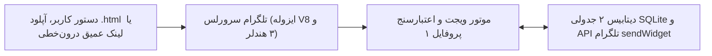

**ربات ویجت تلگرام** ([AZiPA/telegram-widget-bot](https://github.com/AZiPA/telegram-widget-bot)) یک **موتور ماژولار ویجت چت پروفایل ۱ (Profile 1 Chat Widget Engine)** است که برای **تلگرام سرورلس (Telegram Serverless)** با `@tgcloud/cli ^0.2.0` طراحی شده است. این پروژه با جاوااسکریپت خالص ESM (`"type": "module"`) درون ایزوله‌های بدون‌وضعیت V8 و همراه با دیتابیس داخلی SQLite (`sdk/db`)، بدون `node_modules` در زمان اجرا و بدون ماژول‌های داخلی Node.js درون `tgcloud/` اجرا می‌شود.

کد منبع تماماً سمت سرور پروژه شامل `43` ماژول `.js` است و یک موتور ویجت پروفایل ۱، `3` ویجت تعاملی Mini-HTML آماده، ابزار زنده اعتبارسنجی و اجرای فایل‌های `.html` سفارشی و `3` اندپوینت API مینی‌اپ (`POST /api/*`) را فراهم می‌کند (در `tgcloud.jsonc` هیچ فرانت‌اند `"static"` برای مینی‌اپ پیکربندی نشده است). رابط کاربری ربات درون تلگرام **فقط انگلیسی (`en-US`)** است (دیکشنری ترجمه داخلی وجود ندارد)، اما مستندات و راهنماهای مخزن به دو زبان فارسی و انگلیسی ارائه می‌شوند و پروژه تحت مجوز `MPL-2.0` منتشر شده است.

:::caution[دسترس‌پذیری در سرور تست تلگرام و محدودیت‌های زمان اجرا]
۱. **فقط سرور تست تلگرام (غیرفعال در پروداکشن):** تلگرام در حال حاضر ویجت‌های چت (Chat Widgets) را به صورت سراسری روی سرورهای عمومی پروداکشن غیرفعال کرده است؛ رندر زنده ویجت در چت اکنون **فقط روی سرور تست تلگرام (Test Server)** کار می‌کند تا زمانی که تلگرام این قابلیت را روی سرورهای اصلی فعال نماید.
۲. **محدودیت مسیریابی `widget_query` در `@tgcloud/cli 0.2.0`:** دستور `npx tgcloud webhook sync` فهرست `allowed_updates` را از نام فایل‌های درون `tgcloud/handlers/` (`message`، `callback_query`، `inline_query`) استخراج می‌کند و هنوز از `handlers/widget_query.js` یا `handlers/shared_widget_query.js` پشتیبانی نمی‌کند. به همین دلیل، `widget-query-router.js` آپدیت‌های `widget_query` و `shared_widget_query` را درون `message.js` و `callback_query.js` رهگیری کرده و با پل‌های کالبک `wg:<data>` و اندپوینت `POST /api/widgetQuery` تکمیل می‌کند.
۳. **پرچم‌های پیش‌فرض چت خصوصی:** به صورت پیش‌فرض مقدار `ALLOW_SHARED_WIDGETS` و `ALLOW_GROUP_WIDGETS` برابر `false` است و ویجت‌ها به چت خصوصی محدود شده‌اند. در این حالت، **کرنومتر آفلاین (`/timer`)**، **اعتبارسنج و اجراگر فایل `.html` سفارشی** و **اندپوینت‌های مینی‌اپ** فوراً کار می‌کنند، اما **دوئل ضربه (`/duel`)** برای پیوستن بازیکن دوم نیازمند فعال‌سازی پرچم‌های گروهی یا اشتراکی است.
:::

## جریان کلی پردازش آپدیت و ویجت

## ویژگی‌های کلیدی

### ۱. سه ویجت آماده Mini-HTML پروفایل ۱

- **کرنومتر (`/timer [title]`):** یک ویجت آفلاین و تماماً سمت کلاینت (`isShared: false`، `allowQueries: false`، `width: 0`، `height: 550`) با صفحه آنالوگ SVG و جدول دیجیتال `HH:MM:SS.d`، بازخورد لمسی (`HapticFeedback.impactOccurred('light')`)، ذخیره محلی در `localStorage`/`sessionStorage` (تا `100` دور) و بدون هیچ نوشتن در جدول‌های SQLite.
- **نظرسنجی زنده (`/poll Question | Option 1 | Option 2 ...`):** از `2` تا `5` گزینه جداشده با `|` پشتیبانی می‌کند و دارای ذخیره‌سازی دوحالته است: هنگام `ALLOW_SHARED_WIDGETS: false` شمارش‌ها را در `widget_instances` ذخیره می‌کند و هنگام فعال بودن آن از `shared_widgets` و `editSharedWidgetData` (`cacheTime: 15` ثانیه) بهره می‌برد—همراه با نسخه یکنوای `r` و الگوی **Commit-After-Edit**.
- **دوئل ضربه (`/duel [target]`):** بازی نوبتی دونفره با امتیاز هدف محدود به `3` تا `15` (پیش‌فرض `5`) که در `chatData` ذخیره شده و خلاصه قابل فوروارد را در `publicData.summary` نگه می‌دارد.

### ۲. اعتبارسنج زنده و سندباکس `.html` سفارشی

کاربران چت خصوصی (یا شناسه‌های مجاز در `CUSTOM_UPLOAD_ADMIN_IDS`) می‌توانند فایل‌های `.html`، `.htm` یا `text/html` تا سقف `65,536` بایت (`64 KB`) ارسال کنند. موتور ویجت دستورالعمل‌های `<!-- @tg-widget {...} -->` و پرچم‌های کپشن را پارس می‌کند، HTML را فشرده می‌سازد، سقف‌های **پروفایل ۱** (حجم خام، فشرده‌سازی deflate با استاندارد وب V8 `CompressionStream('deflate')`، عمق DOM، تعداد تگ و ممنوعیت APIهای شبکه) را بررسی می‌کند، ویجت را ارسال کرده و کوئری‌های سندباکس (`chat:<json>`، `state:<json>` یا بازتاب JSON) را پاسخ می‌دهد.

### ۳. موتور ماژولار با ثبت خودکار

برای ساخت یک ویجت جدید کافی است یک پوشه در `tgcloud/lib/widgets/definitions/<type>/` با ماژول‌های خالص `state.js` و `template.js` بسازید. با اجرای `node scripts/validate-widgets.js`، کاتالوگ `tgcloud/lib/widgets/registry/catalog.js` به صورت خودکار بازسازی شده و سقف‌های خام (`<= 32,768` B) و فشرده zlib-9 (`<= 4,096` B) پروفایل ۱ بررسی می‌شوند.

### ۴. منوی اشتراک‌گذاری، حالت درون‌خطی و APIهای مینی‌اپ

- **منوی پویا `/share` و لینک‌های عمیق:** دستور `/share` دکمه‌های شیشه‌ای را از `catalog.js` می‌سازد و `/start launch_<type>` مستقیماً ویجت موردنظر را اجرا می‌کند.
- **حالت درون‌خطی (`@bot [query]`):** ویجت‌ها را بر اساس `type`، `title` یا `description` فیلتر کرده و کارت‌های `article` با لینک عمیق `https://t.me/<bot>?start=launch_<type>` برمی‌گرداند.
- **اندپوینت‌های Fail-Closed مینی‌اپ:** سه مسیر `POST /api/*` (`/api/listWidgets`، `/api/sendWidget`، `/api/widgetQuery`) پیش از هر عملیاتی هویت `ctx?.initData?.user` را سخت‌گیرانه اعتبارسنجی می‌کنند.

### ۵. پایپ‌لاین CI/CD تک‌سکرت

گردش‌کار آماده GitHub Actions روی Node.js `26` تمام ویجت‌ها را برابر محدودیت‌های پروفایل ۱ اعتبارسنجی کرده و تنها با یک سکرت مخزن (`TGCLOUD_TOKEN` با قالب `app<id>:<secret>`) ربات را در تلگرام سرورلس دیپلوی می‌کند.

## گام‌های بعدی

- [راه‌اندازی و دیپلوی](/fa/projects/telegram-widget-bot/setup/) — تنظیمات `@BotFather`، استقرار تک‌سکرت با GitHub Actions و دستورات محلی `@tgcloud/cli`.
- [ویجت‌ها، دستورات و آپلود سفارشی](/fa/projects/telegram-widget-bot/widgets-commands/) — بررسی کرنومتر، نظرسنجی، دوئل ضربه، لینک‌های عمیق و آپلود `.html` سفارشی.
- [موتور ویجت و راهنمای ساخت ویجت](/fa/projects/telegram-widget-bot/widget-engine/) — معماری موتور، سقف‌های پروفایل ۱ و نحوه افزودن ویجت جدید.
- [پیکربندی، دیتابیس و API مینی‌اپ](/fa/projects/telegram-widget-bot/config-schema-api/) — آشنایی با `WIDGET_CONFIG`، هندلرها، ۲ جدول SQLite و اندپوینت‌های مینی‌اپ.
