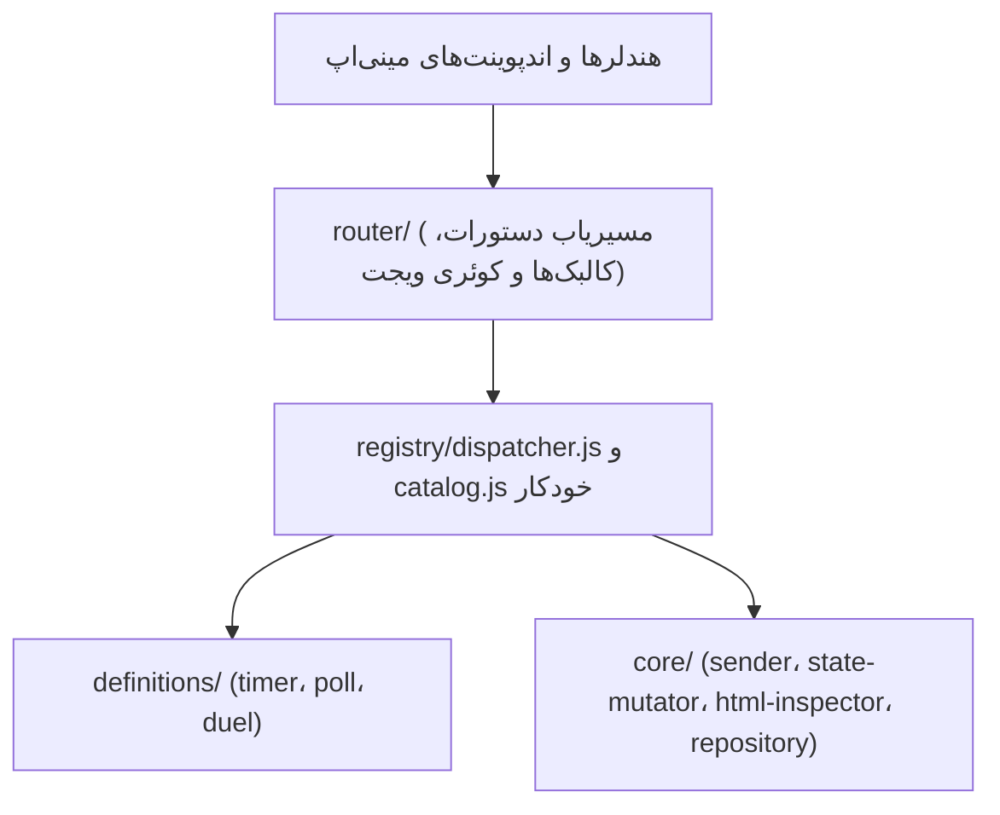

**ربات ویجت تلگرام** مسیریابی، کشف رجیستری، تغییر وضعیت، بازرسی حجم HTML و قالب‌های ویجت را در یک موتور ماژولار زیر پوشه `tgcloud/lib/widgets/` جدا کرده است تا ماژول‌های خالص رندر از ابزارهای SDK تلگرام سرورلس مستقل بمانند.

## معماری موتور ویجت



## ۱. ساخت و ثبت خودکار ویجت جدید

هر ویجت آماده در یک پوشه اختصاصی در مسیر `tgcloud/lib/widgets/definitions/<type>/` قرار می‌گیرد:

1. **`index.js`:** توصیف‌گر ویجت را اکسپورت می‌کند (`type`، ترتیب `order` در کاتالوگ، `title`، `description`، ابعاد، `isShared`، `allowQueries` و فراداده).
2. **`state.js`:** سازنده خالص وضعیت اولیه که `chatData` و `publicData` را از روی پارامترهای دستور یا API برمی‌گرداند.
3. **`template.js`:** سازنده خالص قالب HTML (با امکان استفاده از توابع کمکی خالص در `template-utils.js`).
4. **`actions.js` *(اختیاری)*:** پردازشگرهای اکشن‌های کوئری برای ویجت‌های تعاملی که فقط هنگام دریافت `widget_query` مرتبط به صورت تنبل از طریق `import()` پویا بارگذاری می‌شوند.

:::tip[ماژول‌های `state.js`، `template.js` و `template-utils.js` را ۱۰۰٪ خالص نگه دارید]
درون فایل‌های `state.js`، `template.js` و `template-utils.js` هرگز `sdk`، `sdk/db` یا مخازن دیتابیس را ایمپورت نکنید. خالص نگه داشتن منطق رندر باعث می‌شود اسکریپت `node scripts/validate-widgets.js` بتواند تمام ویجت‌ها را در محیط Node.js CI و بیرون از ایزوله V8 تلگرام اجرا و اعتبارسنجی کند.
:::

### ثبت بدون دخالت دست در کاتالوگ

پس از ساخت یا ویرایش هر ویجت در `definitions/`، دستور اعتبارسنجی را اجرا کنید:

```bash
node scripts/validate-widgets.js    # یا: npm run validate
```

اسکریپت `validate-widgets.js` به طور خودکار تمام پوشه‌های تعریف ویجت را کشف کرده، فایل `tgcloud/lib/widgets/registry/catalog.js` را بر اساس `order` بازتولید می‌کند و خروجی HTML ویجت‌ها را با پارامترهای پیش‌فرض و مرزی بررسی می‌نماید.

## ۲. سقف‌های پروفایل ۱ و محدودیت‌های زمان اجرا

هر دو ابزار `scripts/validate-widgets.js` (در زمان ساخت/CI) و `core/html-inspector.js` (در زمان اجرای آپلود `.html` سفارشی) محدودیت‌های **پروفایل ۱ تلگرام (Profile 1)** را اعمال می‌کنند:

| سقف / محدودیت | حد مجاز | توضیحات |
| :--- | :--- | :--- |
| **حجم خام HTML** | `<= 32,768` B (`32 KB`) | سقف مسدودکننده پس از کمینه‌سازی و حذف اختیاری تگ‌های پوسته (`> 28,000` B). |
| **حجم فشرده Deflate / Zlib-9** | `<= 4,096` B (`4 KB`) | سقف مسدودکننده بدنه فشرده؛ در CI با zlib-9 و در V8 با `CompressionStream('deflate')` بررسی می‌شود. |
| **تعداد Heavy Boxes** | `<= 16` | سقف پیچیدگی چیدمان در نشانه‌گذاری ویجت. |
| **تعداد Backdrop Filters** | `<= 2` | محدودیت تعداد عناصر `backdrop-filter` برای کارایی رندر در کلاینت. |
| **بایت‌های اسکریپت پیچیده** | `<= 8,192` B | سقف حجم اسکریپت‌های تعبیه‌شده. |
| **طول متن سند** | `<= 48,000` کاراکتر | سقف طول متن رندرشده داخل سند ویجت. |
| **داده‌های JSON وضعیت و پاسخ** | هر کدام `<= 1,024` B | به صورت جداگانه برای `chat_data`، `public_data` و پاسخ `answerWidgetQuery` اعمال می‌شود. |
| **داده کوئری `widget_query`** | `1` تا `64` B | بازه مجاز طول داده ارسالی در هر کوئری یا کالبک ویجت. |
| **ابعاد ویجت (`width` / `height`)** | `width`: `0` یا `200`–`600` px؛ `height`: `0` یا `50`–`600` px | مقدار `0` ابعاد را به پیش‌فرض کلاینت تلگرام می‌سپارد. |
| **محدودیت‌های DOM در `.html` سفارشی** | عمق `<= 1,024`، تگ‌ها `<= 2,000`، طول صفت `<= 8,192` | قوانین اعتبارسنجی مسدودکننده برای فایل‌های آپلودی `.html`. |
| **APIهای ممنوعه شبکه** | `0` مجاز | استفاده از `fetch`، `XMLHttpRequest`، `WebSocket`، `EventSource` و `navigator.sendBeacon` را مسدود می‌کند. |

## ۳. یکپارچگی وضعیت و استانداردهای وب در ایزوله V8

### تفاوت `chat_data`، `public_data` و اسنپ‌شات فوروارد

- **`chat_data` (محرمانه / مختص چت):** وضعیت تغییرپذیر هر چت مانند شناسه‌های بازیکنان، نوبت و امتیازهای دوئل ضربه (`p1`، `p2`، `turn`، `target`، `winner`، `r`) یا نگاشت رای‌دهندگان نظرسنجی (`chatData.voters`) را نگهداری می‌کند.
- **`public_data` (عمومی / اسنپ‌شات فورواردی):** خلاصه امن برای نمایش عمومی مانند تعداد آرا یا `publicData.summary` در دوئل ضربه را ذخیره می‌کند. هنگام فوروارد پیام (`TW.isForward`) یا نبود `chatData`، ویجت به صورت خودکار به نمای خلاصه فقط‌خواندنی سوئیچ می‌شود.

### شماره نسخه یکنوای `r` و الگوی Commit-After-Edit (`state-mutator.js`)

برای پیشگیری از ناهماهنگی بین SQLite و کش ویجت در سرورهای تلگرام:

1. **الگوی Commit-After-Edit:** ماژول `state-mutator.js` ابتدا درخواست `editMessageWidgetData` یا `editSharedWidgetData` را به Bot API تلگرام می‌فرستد و **تنها پس از موفقیت**، JSON جدید را در SQLite ثبت می‌کند.
2. **نسخه یکنوای `r`:** هر تغییر، شمارنده `r` را افزایش می‌دهد تا درخواست‌های هم‌زمان یا قدیمی‌تر باعث بازگشت رابط کاربری به وضعیت قبلی نشوند.

### استانداردهای وب بدون Node.js در ایزوله V8 (`html-inspector.js`)

ایزوله‌های تلگرام سرورلس شامل ماژول‌های داخلی Node.js مانند `Buffer` یا `node:zlib` نیستند. به همین دلیل، `html-inspector.js` منحصراً از APIهای استاندارد وب—یعنی `TextEncoder`، `TextDecoder`، `CompressionStream('deflate')`، `Response` و `ReadableStream`—استفاده می‌کند تا منطق بازرسی UTF-8 و فشرده‌سازی پروفایل ۱ به طور یکسان هم در ایزوله V8 و هم در Node.js اجرا شود.

## گام‌های بعدی

- [پیکربندی، دیتابیس و API مینی‌اپ](/fa/projects/telegram-widget-bot/config-schema-api/) — مرور ثابت‌های `WIDGET_CONFIG`، هندلرها، جدول‌های SQLite و APIهای مینی‌اپ.
- [ویجت‌ها، دستورات و آپلود سفارشی](/fa/projects/telegram-widget-bot/widgets-commands/) — مشاهده نحوه کاربرد عملی این سقف‌ها در ویجت‌های آماده و آپلود `.html`.
- [راه‌اندازی و دیپلوی](/fa/projects/telegram-widget-bot/setup/) — تنظیم پایپ‌لاین اعتبارسنجی CI و دیپلوی در تلگرام سرورلس.
