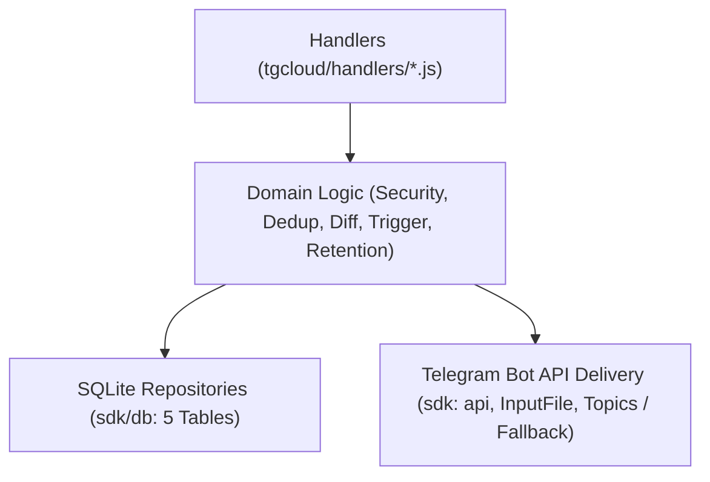

**Telegram Business Assistant** targets **Telegram Serverless** (`@tgcloud/cli ^0.2.0`), executing stateless V8 isolate functions backed by a built-in SQLite database.

## Serverless V8 Runtime Invariants

- **Zero Runtime Dependencies:** Deployed code runs with zero runtime `node_modules`. Modules inside `tgcloud/` may import **only** the built-in `sdk` (`db`, `api`, `fetch`, `InputFile`, `BotApiError`) / `sdk/db` and relative `.js` files inside `tgcloud/`.
- **Flat Handlers Directory:** `tgcloud/handlers/` is strictly flat (one level deep).
- **Bot-Only Surface:** `tgcloud.jsonc` defines no `"static"` front-end and there are no Mini App `endpoints/`.

## Component Architecture



## Official Update Handlers (`tgcloud/handlers/`)

| Handler File | Update Type | Responsibility |
| :--- | :--- | :--- |
| `message.js` | `message` | Handles owner private-chat commands (`/start`, `/trigger`, `/autodelete`) and CLI owner bootstrap (`{owner_id}` with `{ci_bootstrap: true}`); rejects non-owners and groups. |
| `business_connection.js` | `business_connection` | Validates single-owner access, updates `connections.is_enabled`, and delivers **🔗 Telegram Business Connected**. |
| `business_message.js` | `business_message` | Archives incoming and outgoing Business messages, runs View-Once capture and smart-trigger auto-delete on owner replies, and triggers ~2% opportunistic retention cleanup. |
| `edited_business_message.js` | `edited_business_message` | Filters false positives via `isMeaningfulEdit`, updates `messages.edit_history` with optimistic `edit_date` checks, and sends silent 1-message or 3-message diffs. |
| `deleted_business_messages.js` | `deleted_business_messages` | Atomically claims incoming deleted messages (up to `MAX_DELETE_BATCH = 25`), reconstructs albums (`sendMediaGroup`) or 4,000-character digests, and summarizes unarchived deletions. |

## SQLite Database Schema (`tgcloud/schema.js`)

| Schema Export | SQLite Table | Purpose & Key Guarantees |
| :--- | :--- | :--- |
| `connections` | `connections` | Stores Business connection state including `is_enabled` (`false` when disabled globally). |
| `settings` | `settings` | Persists `owner_id`, View-Once trigger text, `/autodelete` state, and `topics_disabled_until` cooldown. |
| `messages` | `messages` | Archives messages (`is_incoming`, `edit_history`, View-Once capture state) with a unique index on `(business_connection_id, chat_id, message_id)`. |
| `rawUpdates` | `raw_updates` | Opt-in raw update diagnostics populated only when `DEBUG_RAW_UPDATES` is `true` (`3`-day retention). |
| `contactTopics` | `contact_topics` | Maps each Business contact to a private Forum Topic using atomic lease `status`: `'creating' \| 'ready'`. |

## Maintenance & Schema Rules

### Routine `tgcloud` Commands

```bash
npx tgcloud status         # or: npm run status
npx tgcloud push           # or: npm run deploy (code only; never alters DB)
npx tgcloud migrate --dry-run
npx tgcloud migrate --safe
npx tgcloud migrate --yes
npx tgcloud webhook
npx tgcloud webhook sync
```

### Serverless SQLite Schema Rules

- **No Foreign Keys:** `PRAGMA foreign_keys` is disabled in Telegram Serverless SQLite; calling `.references()` or `foreignKey()` throws at runtime/migration.
- **Safe Drops:** Mark obsolete columns or tables with `.deprecated('reason')` first, then apply the drop via `npx tgcloud migrate`.
- **Column Type Changes:** Execute manual column type migrations explicitly using `db.run(...)`.

## Contributing, Privacy & License

- **Contributing Boundaries:** Keep all runtime additions inside `tgcloud/` using only built-in `sdk` / `sdk/db` imports and relative `.js` paths, maintain a flat `tgcloud/handlers/` directory, and keep zero runtime `node_modules`.
- **Privacy Notice:** This assistant is intended strictly for personal, single-owner Telegram Business use. The bot owner is solely responsible for complying with applicable local privacy and consent laws as well as Telegram's Terms of Service and Bot Developer Terms.
- **License:** Distributed under the **Mozilla Public License 2.0 (`MPL-2.0`)**.

## Related Pages

- [Overview & Features](/projects/chat-automation/) — Core capabilities and update flow.
- [Setup & Deployment](/projects/chat-automation/setup/) — `@BotFather`, CI/local deployment, and Telegram Business rights.
- [Commands & Configuration](/projects/chat-automation/commands-config/) — Private commands and `tgcloud/lib/config.js` defaults.
