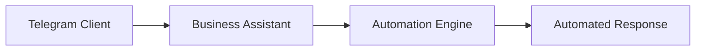

Telegram Business Assistant automates customer replies, rule-based message routing, and structured workflows for Telegram Business accounts.

## Architecture Overview

Return to the [AZiPA home page](/).
