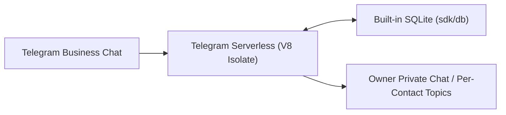

**Telegram Business Assistant** ([AZiPA/telegram-chat-automation](https://github.com/AZiPA/telegram-chat-automation)) is a personal, single-owner automation assistant (also known as a Telegram Secretary) for **Telegram Business** accounts. Built for **Telegram Serverless** (`@tgcloud/cli ^0.2.0`), it runs inside V8 isolates with a built-in SQLite database (`sdk/db` Drizzle-style DSL), zero runtime `node_modules`, and no VPS, containers, or external hosting required.

:::note[Bot-Only Serverless Project]
`tgcloud.jsonc` defines no `"static"` front-end and there are no Mini App `endpoints/`. All interactions happen directly inside Telegram—between your Business chats and your private chat with the bot. The repository uses `"private": true` in `package.json` as a bot deployment project and is licensed under `MPL-2.0`.
:::

## High-Level Update Flow

## Core Capabilities

### 1. Deleted Message Recovery & Batch Digests

Handled via `deleted_business_messages`:

- **Atomic Deduplication & Neutral Headers:** Atomically claims incoming deleted messages to prevent duplicate alerts on retried webhooks, using neutral headers (`🗑 Message Deleted` / `🗑 Messages Deleted`) without guessing which participant deleted the message.
- **Rich Fidelity:** Preserves original formatting (`entities` / `caption_entities`), structured content summaries (`contact`, `location`, `venue`, `poll`, `dice`, etc.), and `forward_origin` metadata.
- **Smart Batch Grouping:** Groups simultaneous multi-message deletions under one batch header—text and structured items merge into 4,000-character-safe digests, while media albums (`media_group_id`) reconstruct in batches of 2–10 items via `sendMediaGroup`.
- **Safe Bounds & Zero Self-Noise:** Processes up to `25` archived incoming messages per update (`MAX_DELETE_BATCH = 25`) with an overflow notice, and summarizes pre-connection or unarchived deletions (`NOTIFY_UNARCHIVED_DELETES = true`). Deleting your own outgoing messages (`is_incoming = false`) never generates alert noise.

### 2. Silent Edit Tracking

Handled via `edited_business_message`:

- **Concurrency-Safe Snapshots:** Stores edit snapshots in `messages.edit_history` with optimistic `edit_date` concurrency checks and delivers reports silently (`disable_notification: true`).
- **Noise Filtering:** Filters out false-positive Telegram updates—such as automatic link-preview generation where text, entities, media, and metadata did not change—via `isMeaningfulEdit`.
- **Compact 1-Message Mode:** Renders an expandable `<blockquote expandable>` diff for plain, unformatted text edits up to `3,000` combined characters.
- **3-Message Entity-Preserving Mode:** Sends `🔴 Before:` and `🟢 After:` messages with shifted UTF-16 entity offsets—plus before/after media copies when `fileUniqueId` changes—for formatted text, long messages, captions, and media replacements.

### 3. View-Once Media Capture & Hybrid Smart Trigger

- **Capture Before Opening:** Saves incoming View-Once `photo`, `video`, `voice`, and `video_note` media when you reply **before opening** the message—even when Telegram initially delivers a `view_once_placeholder` without a `file_id`.
- **Resilient Delivery Fallback:** If sending directly by `file_id` fails, the bot downloads the file (up to the `20 MB` Bot API limit, `MAX_GETFILE_BYTES = 20971520`) and re-uploads via `InputFile`. If delivery still fails, it rolls back the DB capture claim so you can retry.
- **Hybrid Smart Trigger:** *Any* reply captures uncaptured View-Once media. Replies matching your configured trigger text (default `.`, case-insensitive) are also automatically deleted via `deleteBusinessMessages` when `/autodelete` is `on` and `can_delete_all_messages` is granted.

### 4. Per-Contact Private Chat Topics (`Threaded Mode`)

- **Isolated Contact Threads:** With **Threaded Mode** enabled in `@BotFather`, the bot creates one Forum Topic per contact (`👤 Name (@username)` or `👤 Name [id]`) using atomic DB lease locking (`contact_topics`, status `'creating'` / `'ready'`) to prevent duplicate topics. It also syncs contact renames and self-heals closed or deleted topics.
- **Automatic Fallback & Cooldown:** If Threaded Mode is unavailable, alerts fall back to your main private bot chat with a 10-minute cooldown (`topics_disabled_until`). Running `/start` clears the cooldown immediately.

### 5. Fail-Closed Single-Owner Security & Clean Rotation

- **Strict Ownership Enforcement:** Ownership resolves strictly from `owner_id` in `settings`. If missing or invalid, `getOwnerId()` returns `null` and all commands, business connections, and handlers refuse access.
- **Zero Hardcoded Secrets & Clean Handoff:** Neither `TGCLOUD_TOKEN` nor `OWNER_ID` is hardcoded in source code. Updating `OWNER_ID` triggers `setOwnerId()`, cleaning up stale `contact_topics`, `connections`, and `topics_disabled_until` for the previous owner while keeping archived `messages` intact.
- **Platform-Level Access Restriction:** Enabling **Restrict bot usage** (with the `OWNER_ID` account in **Allowed users**) in the `@BotFather` Mini App adds Telegram platform-level protection on top of the bot's fail-closed `OWNER_ID` check—see [Setup & Deployment](/projects/chat-automation/setup/).

### 6. Opportunistic Retention & Opt-In Debug Logging

- **Automatic Pruning:** Prunes `messages` older than `30` days (`RETENTION_DAYS`) and `raw_updates` older than `3` days (`RAW_UPDATES_RETENTION_DAYS`) opportunistically on ~2% of `business_message` updates.
- **Privacy-First Logging:** `DEBUG_RAW_UPDATES` is `false` by default so raw payloads are not stored unless explicitly enabled.

## Next Steps

- [Setup & Deployment](/projects/chat-automation/setup/) — Configure `@BotFather`, deploy via GitHub Actions CI or `@tgcloud/cli`, bootstrap `OWNER_ID`, and activate Telegram Business rights.
- [Commands & Configuration](/projects/chat-automation/commands-config/) — Review private owner commands and `tgcloud/lib/config.js` constants.
- [Architecture & Schema](/projects/chat-automation/architecture/) — Inspect V8 isolate runtime rules, the 5 handlers, 5 SQLite tables, and maintenance workflows.
