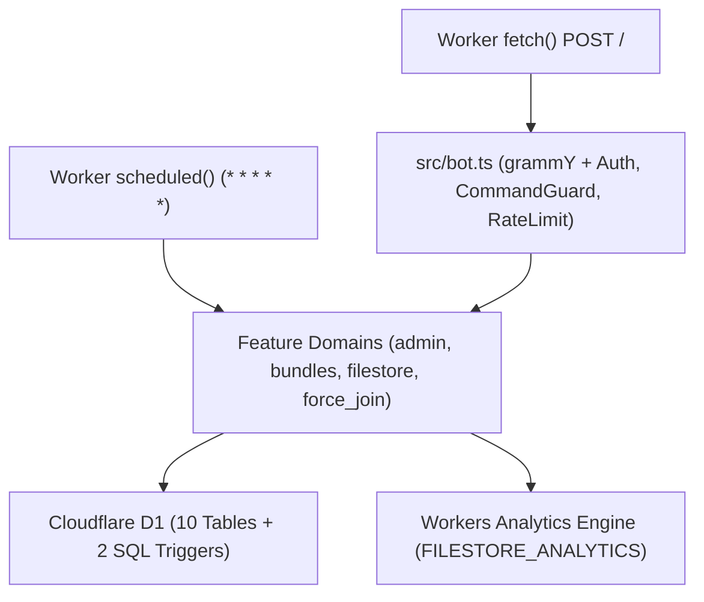

**Telegram Uploader Bot (Cloudflare Workers)** combines a clean TypeScript worker entrypoint (`src/index.ts`), a `grammy` bot pipeline (`src/bot.ts`), raw parameterized **Cloudflare D1** SQL queries, **Workers Analytics Engine** telemetry, and a multi-cadence **Cron Trigger**.

## 1. Component Architecture

## 2. Modular `src/` Layout

| Module / Directory | Responsibility |
| :--- | :--- |
| `src/index.ts` | Cloudflare Worker `fetch` (method/path/secret verification, pre-middleware ban drop) and `scheduled` cron handler. |
| `src/bot.ts` | Wires `grammy ^1.46.0` instance, middleware chain, and feature routers. |
| `src/config.ts` | Defines `LIMITS`, `UI_CONFIG`, `QUOTA_CACHE_CONFIG`, and `LOGGING_CONFIG`. |
| `src/core/` | `logger.ts` (`LoggerService.alert` + Analytics Engine) and `types.ts` (`Env`, context types). |
| `src/features/` | Domain modules: `admin/`, `bundles/`, `filestore/`, and `force_join/`. |
| `src/locales/` | `en.ts` and `fa.ts` totaling **322 keys** (321 UI strings + `ordinals`), validated by `scripts/verify.mjs`. |
| `src/middlewares/` | `auth.ts` (`OWNER_ID` & role resolution), `command_guard.ts`, and `rate_limit.ts` (`3 req / 5s`). |
| `src/shared/` | `buttons.ts` (Bot API 9.4 styles), `crypto.ts` (Base62, UUID, SHA-256), and `formatters.ts`. |

## 3. Scheduled Cron Pipeline (`crons = ["* * * * *"]`)

The single per-minute `scheduled()` handler branches across three cadences:

| Cadence | Trigger Condition | Work Executed |
| :--- | :--- | :--- |
| **Every Minute** | Always (`* * * * *`) | Sweeps up to `25` due `deletion_queue` records (`delete_at <= unixepoch()`, `LIMIT 25`) and batch-deletes up to `100` messages per `api.deleteMessages()` call (hard-capped at `35` Bot API subrequests; pauses immediately on HTTP 429). |
| **Every 15 Minutes** | `UTC minute % 15 === 0` | Purges up to `10` expired or abandoned one-time bundles, and rotates up to `5` due auto-rotating channel bundles to a new UUID while editing inline buttons via `api.editMessageReplyMarkup()` (auto-disables rotation on HTTP 400/403). |
| **Weekly** | Sunday `00:00–03:00 UTC` | Opportunistically prunes up to `25` rows older than `7` days from `user_downloads` per tick inside `executionCtx.waitUntil()`. |

## 4. Cloudflare D1 Schema (`schema.sql`)

The D1 database uses **10 tables** and **2 SQL triggers** queried exclusively with raw parameterized statements (`env.DB.prepare(...).bind(...)`, `env.DB.batch(...)`):

### 10 D1 Tables

| Table | Purpose |
| :--- | :--- |
| `bundles` | Stores bundle metadata (`code`, `protect_content`, `is_one_time`, `consumed_by`, `passcode_hash`, `expires_at`, rotation settings, and single-row `items` JSON). |
| `admin_sessions` | Tracks open `/upload`, `/batch`, and `/edit` sessions with `600`s inactivity timeouts. |
| `bundle_votes` | Persists per-user `👍 / 👎` votes per bundle. |
| `deletion_queue` | Schedules delivered message IDs and `delete_at` timestamps for minute cron cleanup. |
| `admins` | Stores `owner`, `super_admin`, and `admin` assignments. |
| `vips` | Stores VIP user IDs and expiration timestamps (`0` for lifetime). |
| `user_quotas` | Tracks user ban status and per-user rate/quota overrides. |
| `user_downloads` | Logs per-user daily and per-bundle download counts enforced by SQL triggers. |
| `system_config` | Persists dynamic bot configuration (`daily_limit`, `file_daily_limit`, `maintenance_mode`, `auto_delete_seconds`, etc.). |
| `force_channels` | Stores up to `8` Force-Join channels, button labels, invite links, and target join caps. |

### 2 SQL Enforcement Triggers

| Trigger | Purpose |
| :--- | :--- |
| `trg_user_downloads_limit_insert` | Atomically blocks `INSERT` into `user_downloads` when a user reaches their daily or per-link quota cap. |
| `trg_user_downloads_limit_update` | Atomically blocks `UPDATE` on `user_downloads` when an increment would exceed daily or per-link limits. |

## 5. Cloudflare Workers & D1 Free-Tier Engineering

- **10 ms Sync CPU Ceiling:** Uses non-blocking async I/O, atomic Compare-And-Swap mutations, and bounded in-memory `CappedMap` LRU caches (`QUOTA_CACHE_CONFIG`, 5-min stats cache) to stay well within free-tier CPU limits.
- **50 Subrequest Ceiling:** Caps outgoing Bot API subrequests at **35** per invocation (and leverages 1-subrequest `api.copyMessages()` whenever `storage_message_id` is available), leaving safe headroom while D1 queries draw from D1's separate 1,000-query budget.
- **6 Concurrent Outgoing Sockets:** `MEMBERSHIP_CONCURRENCY = 6` bounds Force-Join checks into safe 6-socket waves.
- **100k Daily D1 Writes / 5M Rows Scanned:** Storing bundle media as a single-row JSON array in `bundles.items` cuts D1 writes by roughly **96%** compared to normalized item tables, while `json_array_length(items)` avoids reading large JSON blobs during `/stats` and `/search`. Free-tier D1 limit errors trigger `isD1FreeTierError()` with a 1-hour alert cooldown.
- **8-Check `scripts/verify.mjs` Suite:** Verifies **322** EN/FA dictionary keys for key parity, `{placeholder}` parity, balanced HTML tags, zero unused keys, and strict **64-byte** Telegram `callback_data` compliance across all 40 callback formats.

## License

Distributed under the **Mozilla Public License 2.0 (`MPL-2.0`)**.

## Next Steps

- [Overview & Highlights](/projects/telegram-uploader-bot-cloudflare/) — Return to the Cloudflare edition summary and comparison.
- [Setup & Deployment](/projects/telegram-uploader-bot-cloudflare/setup/) — Review D1 provisioning, CI pipeline, and webhook setup.
- [Commands & Configuration](/projects/telegram-uploader-bot-cloudflare/commands-config/) — Browse all primary commands and configuration keys.
