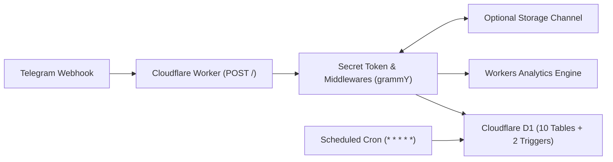

**Telegram Uploader Bot (Cloudflare Workers)** ([AZiPA/telegram-uploader-bot-cloudflare](https://github.com/AZiPA/telegram-uploader-bot-cloudflare)) is the `v3.3.0` edge edition of the Telegram file distribution bot, built with **TypeScript**, **`grammy ^1.46.0`**, and **`wrangler ^4.0.0`** (`compatibility_date = "2026-10-01"`, `nodejs_compat`) on **Cloudflare Workers** and **Cloudflare D1**. It executes raw parameterized D1 SQL (`env.DB.prepare(...).bind(...)` and `env.DB.batch(...)`) with zero ORM overhead, zero KV/R2/Durable Objects, and zero VPS hosting.

:::note[Backend-Only Edge Worker]
This Worker exposes no Telegram Mini App (`has_main_web_app: false`) and serves no static frontend assets. It handles a single HTTP webhook route (`POST /<WEBHOOK_PATH>`) authenticated via `X-Telegram-Bot-Api-Secret-Token` (wrong method or path returns `404 Not Found`; invalid secret returns `403 Forbidden`). Distributed under **Mozilla Public License 2.0 (`MPL-2.0`)**, it includes bilingual `en` and `fa` dictionaries (`src/locales/en.ts`, `src/locales/fa.ts`) with **322 keys** verified by an 8-check `scripts/verify.mjs` suite.
:::

:::tip[Prefer Telegram Serverless Instead?]
If you want zero-cloud setup running directly inside Telegram's V8 Serverless isolates with a built-in SQLite database and no external Cloudflare account, webhook URL, or cron configuration, see the [Telegram Uploader Bot (Telegram Serverless)](/projects/telegram-uploader-bot/) edition.
:::

## High-Level Edge Flow

## Core Capabilities

### 1. Six Supported Media Types & Atomic Uploads

- **Focused Media Support:** Handles `document`, `video`, `audio`, `photo` (highest resolution), `animation`, and `voice`.
- **Upload & Edit Workflows:** Supports `/upload` for single items, `/batch` for up to **20 items per session** (`MAX_PER_SESSION_UPLOAD = 20`), and `/edit <code>` / `/review <code>` using atomic Compare-And-Swap updates up to **25 items per bundle** (`MAX_BUNDLE_ITEMS = 25`), with a `600`-second (10-minute) session inactivity timeout.

### 2. One-Subrequest Storage Channel Bulk Delivery

- **Write-Time Mirroring:** When `STORAGE_CHANNEL_ID` is configured, uploaded items mirror via `api.copyMessage()` and store their `storage_message_id` inside `bundles.items` JSON.
- **Ultra-Fast Bulk Fallback:** When every item in a delivery chunk carries `storage_message_id`, the bot delivers up to **10 items in 1 single subrequest** via `api.copyMessages()`, falling back cleanly to sequential `file_id` delivery (and emitting a `LoggerService.alert`) if HTTP 403 or partial errors occur.

### 3. Bot API 9.4 UI, SHA-256 Passcodes & Cron Lifecycles

- **Links & Colored Inline Controls:** Public bundles receive 8-character Base62 codes; protected, rotated, one-time, or PIN-locked bundles upgrade to 36-character RFC 4122 UUID v4 links (`?start=<code>` or `?start=<code>_<pin>`). Chunked delivery (`10` items/chunk) renders Bot API 9.4 colored buttons (`primary`, `success`, `danger`) and `👍 / 👎` voting (`bundle_votes`).
- **Web Crypto SHA-256 PIN Protection (`/setpass`):** Locks bundles with 4–32 character PINs hashed via `${code}:${pin}`, guarded by a **5-strike / 30-minute anti-brute-force lockout** (0 D1 writes).
- **Scheduled Cron Automation:** Runs every minute (`* * * * *`) to sweep `deletion_queue`, runs every 15 minutes to purge expired/abandoned one-time bundles and rotate channel-post links, and runs weekly to prune `user_downloads`.

### 4. Force-Join Gatekeeping & 5-Level RBAC

- **Bounded Force-Join:** Verifies up to **8** channels in waves of at most **6** simultaneous connections (`MEMBERSHIP_CONCURRENCY = 6`, fail-closed on network/flood errors) with a 3-second verify button cooldown and target join limits.
- **Secret-Driven Hierarchy & SQL Quota Enforcement:** Separates Rank 4 (`Owner`), Rank 3 (`Super Admin`), Rank 2 (`Admin`), Rank 1 (`VIP` with 5× daily / 3× per-link quotas), and Rank 0 (`User` with 10 daily / 3 per-link quotas enforced by D1 SQL triggers), plus atomic JSON configuration backups via `/factoryreset confirm` and `/restore`.

## Next Steps

- [Setup & Deployment](/projects/telegram-uploader-bot-cloudflare/setup/) — Configure `@BotFather`, Cloudflare D1, API permissions, Secrets, GitHub Actions CI, and webhook registration.
- [Uploads, Delivery & Protection](/projects/telegram-uploader-bot-cloudflare/features-delivery/) — Review bulk storage copy, SHA-256 `/setpass` protection, Bot API 9.4 UI, and Force-Join mechanics.
- [Roles, Security & Operations](/projects/telegram-uploader-bot-cloudflare/roles-security/) — Examine the 5-level quota matrix, `OWNER_ID` auth, rate limits, and `/restore` JSON backups.
- [Commands & Configuration](/projects/telegram-uploader-bot-cloudflare/commands-config/) — Browse primary commands by role, `Env` bindings, `system_config` keys, and runtime constants.
- [Architecture, D1 Schema & Cron](/projects/telegram-uploader-bot-cloudflare/architecture/) — Inspect the cron schedule, 10 D1 tables, 2 SQL triggers, and Cloudflare free-tier optimizations.
