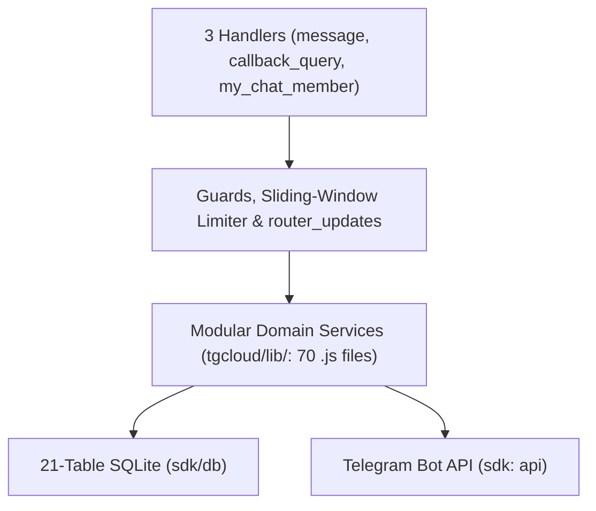

**Telegram Uploader Bot (Telegram Serverless)** runs entirely inside Telegram's V8 Serverless runtime (`@tgcloud/cli 0.2.0`), combining modular JavaScript domain services with a 21-table SQLite schema (`tgcloud/schema.js`).

## 1. Serverless V8 Runtime Invariants

- **Zero Runtime Dependencies:** There are zero runtime `node_modules`, zero `process.env` reads, and zero Node.js built-in imports anywhere inside `tgcloud/`. Modules import only built-in `sdk` / `sdk/db` primitives and relative `.js` files.
- **Backend-Only Deployment:** `tgcloud.jsonc` has no `"static"` property and there is no `tgcloud/endpoints/` directory.
- **Mandatory `await` on Queries:** Every terminal `sdk/db` query returns a Promise and must be explicitly `await`ed before the isolate completes.
- **Ephemeral Isolate Memory:** In-memory maps (such as the 15-second Force-Join cache) reset whenever V8 recycles an isolate; durable state always lives in SQLite.

## 2. Component Architecture

## 3. Modular `tgcloud/lib/` Layout

Business logic is split across **70 `.js` files** organized by domain, paired with **272 localization keys** in 100% parity between `en` and `fa`:

| Directory | Responsibility |
| :--- | :--- |
| `admin/` | RBAC checks, VIPs, bans, global settings, Force-Join administration, and `/sql` / `/terminal` console. |
| `bundles/` | Bundle creation, Bundle Hub (`/manage`), naming, search, expiration TTL, voting, and link rotation. |
| `core/` | `router`, atomic `update_ledger` deduplication, and opportunistic `background` maintenance (30s CAS `last_maint_at` throttle + 180s `maintenance_lease`). |
| `filestore/` | `/upload` & `/batch` session orchestration, storage channel mirroring, chunked delivery, and `source_dead` fallback. |
| `force_join/` | Parallel 6-socket membership waves, 15s cache, 3s verify cooldown, and admin-time invite link management. |
| `locales/` | Bilingual `en` and `fa` dictionaries totaling **272 keys** in strict 1:1 parity. |
| `middlewares/` | Fail-closed Zero-State lock, private-chat guard, maintenance gate, and sliding-window rate limiter. |
| `services/` | Bot API wrappers, live `/postbundle` reply-markup sync, `deletion_queue` sweeps, and custom emoji circuit breaker. |
| `shared/` | Base62 & UUID v4 helpers, formatters, validators, and shared constants. |

## 4. Three Official Update Handlers (`tgcloud/handlers/`)

| Handler File | Update Type | Responsibility |
| :--- | :--- | :--- |
| `message.js` | `message` | Executes CI bootstrap (`ci_bootstrap`), Zero-State `/setbotowner` claim, role commands, interactive FSM prompts with Command Breakout, and media uploads. |
| `callback_query.js` | `callback_query` | Processes chunk pagination (`dl:p:o:<operation_id>:<offset>`), Force-Join verification, bundle voting, Bundle Hub toggles, settings menus, and transfer/reset confirmations. |
| `my_chat_member.js` | `my_chat_member` | Automatically deactivates Force-Join channels whenever the bot is kicked or leaves (`'kicked' \| 'left'`). |

## 5. 21 SQLite Tables (`tgcloud/schema.js`)

The database schema consists of **21 tables** organized across four functional groups:

### Group 1 — Core Bundles & Engagement (6 Tables)

| Table | Purpose |
| :--- | :--- |
| `bundles` | Stores bundle codes (Base62 / UUID v4), titles, `protect_content`, `is_one_time`, expiration TTL, rotation intervals, and `owner_locked` flags. |
| `bundle_votes` | Records per-user like/dislike community votes per bundle. |
| `deletion_queue` | Queues delivered message IDs and target timestamps for batched `api.deleteMessages()` sweeps (up to `100` per batch). |
| `force_channels` | Tracks up to `8` mandatory Force-Join channels, member targets, labels, and cached invite links. |
| `system_config` | Key-value runtime configuration store built with `.withoutRowid()` (`owner_id`, quotas, TTLs, channel snapshots, maintenance leases). |
| `bot_config` | Stores bot-level metadata and configuration snapshots. |

### Group 2 — Access Control, Quotas & Sessions (6 Tables)

| Table | Purpose |
| :--- | :--- |
| `admins` | Stores `owner`, `super_admin`, and `admin` role records with hierarchy metadata. |
| `vips` | Stores VIP user IDs and optional expiration timestamps. |
| `user_quotas` | Tracks daily download counters, rate-limit sliding windows, strikes, and lockout expirations. |
| `user_downloads` | Logs per-user bundle and file download history for analytics (`/stats`, `/top`) and limits. |
| `admin_sessions` | Holds interactive admin FSM state with a 300-second TTL and Command Breakout support. |
| `user_sessions` | Persists active user interaction states across stateless isolate invocations. |

### Group 3 — Durable Upload State Machine (2 Tables)

| Table | Purpose |
| :--- | :--- |
| `upload_sessions` | Tracks open `/upload` and `/batch` staging sessions before `/done` or `/cancel`. |
| `upload_items` | Stores staged media metadata, album order, and storage mirror references (capped at `25` items). |

### Group 4 — Idempotent Delivery Ledger & Routing (7 Tables)

| Table | Purpose |
| :--- | :--- |
| `delivery_operations` | Represents a single logical bundle delivery request (`operation_id`) across paginated chunks. |
| `delivery_attempts` | Tracks individual chunk send attempts and fallback transitions (`file_id` → `source_dead` storage copy). |
| `delivery_items` | Maps individual bundle items inside a delivery operation for deterministic 10-item slicing. |
| `delivery_claims` | Provides atomic claim locking for `is_one_time` burn bundles so only one recipient completes delivery. |
| `delivery_quota_accounts` | Deduplicates user quota charges across retries and paginated chunks of the same delivery operation. |
| `admin_test_continuations` | Tracks admin preview/review pagination flows (`/review`) without affecting public quotas. |
| `router_updates` | Implements atomic concurrency leases per Telegram `update_id` to prevent duplicate webhook execution. |

## 6. Schema Migration Rules & License

- **No Foreign Keys:** Telegram Serverless SQLite runs with foreign keys disabled; calling `.references()` or `foreignKey()` throws at runtime/migration.
- **Safe Additive Migrations:** Always run `npx @tgcloud/cli migrate --safe`. Deleting obsolete tables or columns requires marking them with `.deprecated('reason')` first before applying a drop migration.
- **License:** Distributed under the **Mozilla Public License 2.0 (`MPL-2.0`)**.

## Next Steps

- [Overview & Highlights](/projects/telegram-uploader-bot/) — Return to the high-level project summary.
- [Setup & Deployment](/projects/telegram-uploader-bot/setup/) — Review `@BotFather`, CI secrets, and CLI deployment commands.
- [Commands & Configuration](/projects/telegram-uploader-bot/commands-config/) — Browse all commands and persistent `system_config` keys.
