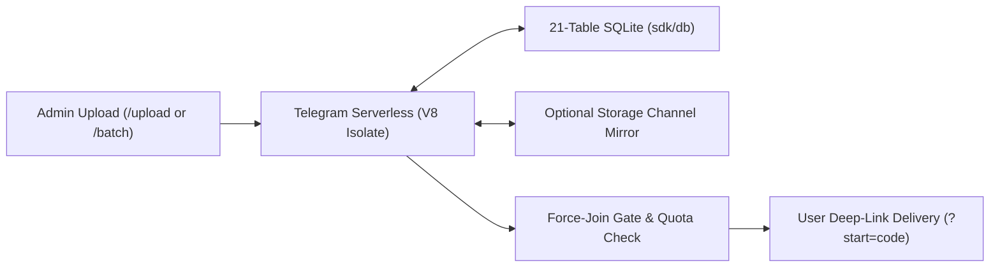

**Telegram Uploader Bot (Telegram Serverless)** ([AZiPA/telegram-uploader-bot](https://github.com/AZiPA/telegram-uploader-bot)) is a production-grade Telegram file storage and distribution bot built natively for **Telegram Serverless** (`@tgcloud/cli 0.2.0`). It executes inside Telegram's V8 Serverless isolates backed by a built-in SQLite database—requiring **zero VPS**, **zero external hosting**, **zero runtime `node_modules`**, and **zero `process.env`**.

:::note[Backend-Only Serverless Bot]
`tgcloud.jsonc` defines no `"static"` property; there is no Mini App and no `tgcloud/endpoints/` directory. All upload sessions, delivery flows, Force-Join checks, and administrative operations run directly inside Telegram chats and inline callbacks. The project is licensed under **Mozilla Public License 2.0 (`MPL-2.0`)** and ships bilingual `en` and `fa` dictionaries (`tgcloud/lib/locales/`) with **272 keys** in 100% parity.
:::

:::tip[Prefer Cloudflare Workers + D1?]
If you want TypeScript with `grammy`, scheduled minute cron triggers, Workers Analytics Engine telemetry, `/setpass` PIN protection, and `/restore` JSON config backups on Cloudflare's edge network, see the [Telegram Uploader Bot (Cloudflare Workers)](/projects/telegram-uploader-bot-cloudflare/) edition.
:::

## High-Level Delivery Flow

## Core Capabilities

### 1. Single & Batch Uploads Across 8 Media Types

- **Flexible Upload Sessions:** Send `/upload` for a single item or `/batch` for multi-file bundles up to **25 items** (`MAX_BUNDLE_ITEMS = 25`), committed with `/done` or aborted with `/cancel`. Media groups (albums) are tracked atomically via `upload_sessions` and `upload_items`.
- **Dynamic Media Allowlist:** Supports `photo`, `document`, `video`, `audio`, `voice`, `video_note`, `animation`, and `sticker`. Runtime filtering reads `system_config.allowed_media_types` (default: `['photo', 'document', 'video', 'audio']`), configurable via the Owner Media GUI.

### 2. Storage Channel Mirroring & Resilient Fallback

- **Automatic Redundancy:** Optionally mirror every upload to a private storage channel via `api.copyMessage()`.
- **Self-Healing Delivery:** Delivery tries direct `file_id` sending first and transparently falls back to `api.copyMessages()` from the storage channel on `source_dead` errors (`FILE_REFERENCE_EXPIRED`, `wrong remote file identifier`). If storage permissions are revoked or content protection is enabled on the storage channel, mirroring self-disables (`storage_channel_active = 'false'`) and alerts the log channel.

### 3. Chunked Delivery, Protection & Ephemeral Lifecycles

- **Idempotent 10-Item Pagination:** Large bundles deliver in chunks of **10 items** (`CHUNK_DELIVERY_SIZE = 10`) with progress headers (`Part 1/3`) and inline continuation (`dl:p:o:<operation_id>:<offset>`), protected against duplicate webhook retries by atomic leases in `router_updates`.
- **Content Protection & Link Formats:** Regular bundles receive 8-character Base62 codes; protected bundles (`protect_content: true`) receive 36-character RFC 4122 UUID v4 links (`crypto.randomUUID()`). Enabling protection on a Base62 bundle automatically upgrades its code to UUID v4.
- **Ephemeral Controls & Live Link Rotation:** Supports queued auto-delete (`/setautodel`), per-bundle or global TTL expiration (`/setexpiry`, `/setbundlettl`), atomic one-time burn bundles (`is_one_time` via `delivery_claims`), and live link rotation that updates `/postbundle` channel post buttons via `api.editMessageReplyMarkup()`.

### 4. Force-Join Gatekeeping & Community Engagement

- **Bounded Parallel Verification:** Supports up to **8** mandatory Force-Join channels (`MAX_FORCE_JOIN_CHANNELS = 8`), checked in batches of at most **6** outgoing sockets (`MAX_OUTGOING_SOCKETS = 6`) with a 15-second in-memory cache and 3-second verify button cooldown (`FORCE_JOIN_THROTTLE_SEC = 3`).
- **Voting & Custom Emoji Circuit Breaker:** Built-in per-user like/dislike voting (`bundle_votes`) and optional Telegram Premium `<tg-emoji>` tags protected by an automatic circuit breaker that falls back to plain Unicode on `ENTITY_CUSTOM_EMOJI_INVALID`.

### 5. Five-Level Role Hierarchy & Fail-Closed Security

- **Granular RBAC:** Enforces **5 access levels**—Owner (Level 4), SuperAdmin (Level 3), Admin (Level 2), VIP (Level 1), and User (Level 0).
- **Fail-Closed Operations:** Restricts interactions to private chats (`private_only`), enforces Zero-State initialization (`bot_uninitialized`) until ownership is claimed, limits abuse with sliding-window rate limiting (`MAX_STRIKES = 5`, `1800`s lockout), supports clean two-step ownership transfer, and provides an Owner-only SQLite console (`/sql`, `/terminal`).

## Next Steps

- [Setup & Deployment](/projects/telegram-uploader-bot/setup/) — Configure `@BotFather`, deploy with GitHub Actions CI or `@tgcloud/cli`, and initialize ownership.
- [Uploads, Delivery & Protection](/projects/telegram-uploader-bot/features-delivery/) — Explore upload workflows, storage fallback, link rotation, and Force-Join mechanics.
- [Roles, Security & Operations](/projects/telegram-uploader-bot/roles-security/) — Review the 5-level role hierarchy, rate limiting, ownership transfer, and SQLite console.
- [Commands & Configuration](/projects/telegram-uploader-bot/commands-config/) — Browse all role-grouped commands, `system_config` keys, and runtime constants.
- [Architecture & SQLite Schema](/projects/telegram-uploader-bot/architecture/) — Inspect V8 isolate invariants, the 3 handlers, and all 21 SQLite tables.
