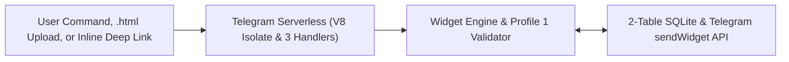

**Telegram Widget Bot** ([AZiPA/telegram-widget-bot](https://github.com/AZiPA/telegram-widget-bot)) is a modular **Profile 1 Chat Widget Engine** built for **Telegram Serverless** (`@tgcloud/cli ^0.2.0`). Written in pure JavaScript ESM (`"type": "module"`), it executes inside stateless V8 isolates backed by built-in SQLite (`sdk/db`) with zero runtime `node_modules` and zero Node.js built-ins inside `tgcloud/`.

The backend-only codebase spans `43` modular `.js` files providing a Profile 1 Chat Widget Engine, `3` built-in interactive Mini-HTML Chat Widgets, a live custom `.html` widget validator and sandbox launcher, and `3` Mini App `POST /api/*` API endpoints (no static Mini App frontend is configured in `tgcloud.jsonc`). Its in-Telegram bot UI is **English-only (`en-US`)** with no internal i18n dictionary, while documentation and repository READMEs are bilingual in English and Persian (`MPL-2.0`).

:::caution[Telegram Test Server Availability & Runtime Caveats]
1. **Test Server Only (Production Disabled):** Telegram currently has Chat Widgets disabled globally on public Production servers—live in-chat widget rendering currently works only on **Telegram's Test Server** until Telegram enables Chat Widgets on production servers.
2. **`@tgcloud/cli 0.2.0` `widget_query` Routing:** `npx tgcloud webhook sync` derives `allowed_updates` from filenames under `tgcloud/handlers/` (`message`, `callback_query`, `inline_query`) and does not yet support `handlers/widget_query.js` or `handlers/shared_widget_query.js`. To bridge this, `widget-query-router.js` intercepts `widget_query` and `shared_widget_query` inside `message.js` and `callback_query.js`, backed by `wg:<data>` callback bridges and `POST /api/widgetQuery`.
3. **Default Private-Only Flags:** By default, `ALLOW_SHARED_WIDGETS` and `ALLOW_GROUP_WIDGETS` are `false`, restricting widgets to private chats. The offline **Stopwatch (`/timer`)**, **Custom `.html` Validator & Launcher**, and **Mini App endpoints** work immediately, while **Tap Duel (`/duel`)** requires enabling group/shared flags so a second opponent can join.
:::

## High-Level Update & Widget Flow

## Core Highlights

### 1. Three Built-In Profile 1 Mini-HTML Widgets

- **Stopwatch (`/timer [title]`):** An offline client-only widget (`isShared: false`, `allowQueries: false`, `width: 0`, `height: 550`) with an Analog SVG dial and Digital `HH:MM:SS.d` lap table, haptic feedback (`HapticFeedback.impactOccurred('light')`), `localStorage`/`sessionStorage` persistence (`100` laps max), and zero SQLite writes.
- **Live Shared Poll (`/poll Question | Option 1 | Option 2 ...`):** Supports `2`–`5` pipe-separated options with dual-mode persistence—per-message `widget_instances` when `ALLOW_SHARED_WIDGETS` is `false`, or `shared_widgets` + `editSharedWidgetData` (`cacheTime: 15` s) when enabled—protected by monotonic revision `r` and **Commit-After-Edit** ordering.
- **Tap Duel (`/duel [target]`):** A turn-based 2-player tap duel (`target` clamped `3`–`15`, default `5`) stored in `chatData`, with a forwarded read-only snapshot summary in `publicData.summary`.

### 2. Live Custom `.html` Validator & Sandbox

Private-chat users (or allowlisted IDs via `CUSTOM_UPLOAD_ADMIN_IDS`) can upload `.html`, `.htm`, or `text/html` files up to `65,536` B (`64 KB`). The engine parses `<!-- @tg-widget {...} -->` directives and caption flags, minifies HTML, verifies **Profile 1** size, DOM depth, tag count, and network-API rules using V8 web standards (`CompressionStream('deflate')`), launches the widget, and routes sandbox queries (`chat:<json>`, `state:<json>`, or JSON echoes) automatically.

### 3. Auto-Registered Modular Engine

Authoring a new built-in widget requires only a folder under `tgcloud/lib/widgets/definitions/<type>/` with pure `state.js` and `template.js` modules. Running `node scripts/validate-widgets.js` automatically discovers definitions, regenerates `tgcloud/lib/widgets/registry/catalog.js`, and enforces raw (`<= 32,768` B) and zlib-9 (`<= 4,096` B) Profile 1 budgets.

### 4. Dynamic Launch Menu, Inline Mode & Mini App APIs

- **Dynamic `/share` & Deep Links:** `/share` generates inline launch buttons from `catalog.js`, and `/start launch_<type>` deep-links directly into launching any registered widget.
- **Inline Launcher (`@bot [query]`):** Filters widgets by `type`, `title`, or `description` and serves `article` deep-link cards (`https://t.me/<bot>?start=launch_<type>`).
- **Fail-Closed Mini App Endpoints:** Three `POST /api/*` routes (`/api/listWidgets`, `/api/sendWidget`, `/api/widgetQuery`) validate `ctx?.initData?.user` strictly before dispatching or mutating widgets.

### 5. Single-Secret CI/CD Pipeline

The included GitHub Actions workflow validates every widget against Profile 1 budgets and deploys to Telegram Serverless on Node.js `26` using only one repository secret: `TGCLOUD_TOKEN` (`app<id>:<secret>`).

## Next Steps

- [Setup & Deployment](/projects/telegram-widget-bot/setup/) — Review `@BotFather` setup, single-secret GitHub Actions CI, and local `@tgcloud/cli` commands.
- [Widgets, Commands & Uploads](/projects/telegram-widget-bot/widgets-commands/) — Explore Stopwatch, Poll, Tap Duel, commands, inline deep links, and custom `.html` uploads.
- [Widget Engine & Authoring](/projects/telegram-widget-bot/widget-engine/) — Learn the modular engine internals, Profile 1 budgets, and how to add new widgets.
- [Configuration, Schema & API](/projects/telegram-widget-bot/config-schema-api/) — Inspect `WIDGET_CONFIG`, handlers, the 2 SQLite tables, and Mini App APIs.
