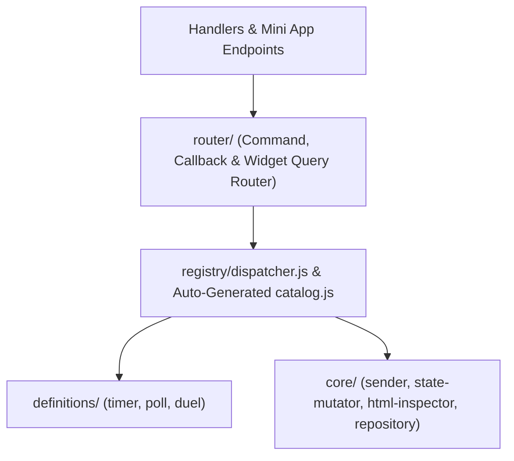

**Telegram Widget Bot** separates routing, registry discovery, state mutation, HTML budget inspection, and concrete widget templates into a clean modular engine under `tgcloud/lib/widgets/`, keeping pure rendering modules decoupled from Telegram Serverless SDK primitives.

## Engine Architecture



## 1. Authoring & Auto-Registering a New Widget

Every built-in widget lives in its own folder under `tgcloud/lib/widgets/definitions/<type>/`:

1. **`index.js`:** Exports the widget descriptor (`type`, catalog `order`, `title`, `description`, dimensions, `isShared`, `allowQueries`, and metadata).
2. **`state.js`:** Pure initial state factory returning initial `chatData` / `publicData` from command or API parameters.
3. **`template.js`:** Pure HTML template builder (sharing pure helpers from `template-utils.js` when needed).
4. **`actions.js` *(Optional)*:** Query handlers for interactive widgets—lazy-loaded at runtime via dynamic `import()` only when a matching `widget_query` arrives.

:::tip[Keep `state.js`, `template.js`, and `template-utils.js` 100% Pure]
Never import `sdk`, `sdk/db`, or database repositories inside `state.js`, `template.js`, or `template-utils.js`. Keeping rendering modules pure lets `node scripts/validate-widgets.js` execute and verify every widget locally in Node.js CI outside Telegram's V8 isolate.
:::

### Zero-Touch Catalog Registration

Run the validation script after adding or modifying any widget under `definitions/`:

```bash
node scripts/validate-widgets.js    # or: npm run validate
```

`validate-widgets.js` automatically discovers every definition directory, regenerates `tgcloud/lib/widgets/registry/catalog.js` ordered by `order`, and checks rendered HTML outputs across default and boundary parameters before allowing deployment.

## 2. Profile 1 Budgets & Runtime Limits

Both `scripts/validate-widgets.js` (at CI/build time) and `core/html-inspector.js` (at runtime for custom `.html` uploads) enforce **Telegram Profile 1** budgets:

| Budget / Constraint | Hard Limit | Notes |
| :--- | :--- | :--- |
| **Raw HTML Size** | `<= 32,768` B (`32 KB`) | Blocking ceiling checked after optional minification / shell tag stripping (`> 28,000` B). |
| **Deflate / Zlib-9 Size** | `<= 4,096` B (`4 KB`) | Blocking compressed payload ceiling validated via zlib-9 in CI and `CompressionStream('deflate')` in V8. |
| **Heavy Boxes** | `<= 16` | Layout complexity cap inspected across widget markup. |
| **Backdrop Filters** | `<= 2` | Limits `backdrop-filter` elements for client rendering performance. |
| **Complex Script Bytes** | `<= 8,192` B | Caps embedded script footprint. |
| **Document Text Length** | `<= 48,000` chars | Caps rendered text length inside the widget document. |
| **JSON State & Answer Payloads** | `<= 1,024` B each | Applies individually to `chat_data`, `public_data`, and `answerWidgetQuery` JSON payloads. |
| **`widget_query` Payload** | `1`–`64` B | Telegram callback/query payload size window. |
| **Widget Dimensions (`width` / `height`)** | `width`: `0` or `200`–`600` px; `height`: `0` or `50`–`600` px | `0` delegates sizing to Telegram's client defaults. |
| **Custom `.html` DOM Limits** | Depth `<= 1,024`, tags `<= 2,000`, attr length `<= 8,192` | Blocking validation rules on uploaded `.html` documents. |
| **Forbidden Network APIs** | `0` allowed | Blocks `fetch`, `XMLHttpRequest`, `WebSocket`, `EventSource`, and `navigator.sendBeacon`. |

## 3. State Consistency & V8 Isolate Web Standards

### `chat_data` vs. `public_data` & Forward Snapshots

- **`chat_data` (Private / Chat-Scoped):** Stores per-chat mutable gameplay or moderation state—such as Tap Duel player IDs, turn state, and scores (`p1`, `p2`, `turn`, `target`, `winner`, `r`), or Poll voter maps (`chatData.voters`).
- **`public_data` (Public / Forwarded Snapshot):** Stores safe display summaries—such as Poll vote counts or Tap Duel's `publicData.summary`. When a message is forwarded (`TW.isForward`) or `chatData` is stripped, interactive controls automatically render a read-only snapshot view.

### Monotonic Revision `r` & Commit-After-Edit (`state-mutator.js`)

To prevent split-brain desynchronization between SQLite and Telegram's widget cache:

1. **Commit-After-Edit:** `state-mutator.js` calls `editMessageWidgetData` or `editSharedWidgetData` **first** and commits the updated JSON to SQLite **only after** the Telegram Bot API update succeeds.
2. **Monotonic Revision (`r`):** Every mutation increments revision counter `r` so out-of-order client reads or stale widget interactions cannot regress newer state.

### Zero-Node Web Standards Inside V8 Isolates (`html-inspector.js`)

Telegram Serverless isolates do not bundle Node.js built-ins like `Buffer` or `node:zlib`. Accordingly, `html-inspector.js` relies exclusively on standard Web APIs—`TextEncoder`, `TextDecoder`, `CompressionStream('deflate')`, `Response`, and `ReadableStream`—so the same Profile 1 compression and UTF-8 inspection logic runs identically inside V8 isolates and Node.js.

## Next Steps

- [Configuration, Schema & API](/projects/telegram-widget-bot/config-schema-api/) — Review `WIDGET_CONFIG`, handlers, SQLite tables, and Mini App APIs.
- [Widgets, Commands & Uploads](/projects/telegram-widget-bot/widgets-commands/) — See how built-in widgets and custom `.html` uploads use these budgets in practice.
- [Setup & Deployment](/projects/telegram-widget-bot/setup/) — Configure CI validation and deploy to Telegram Serverless.
